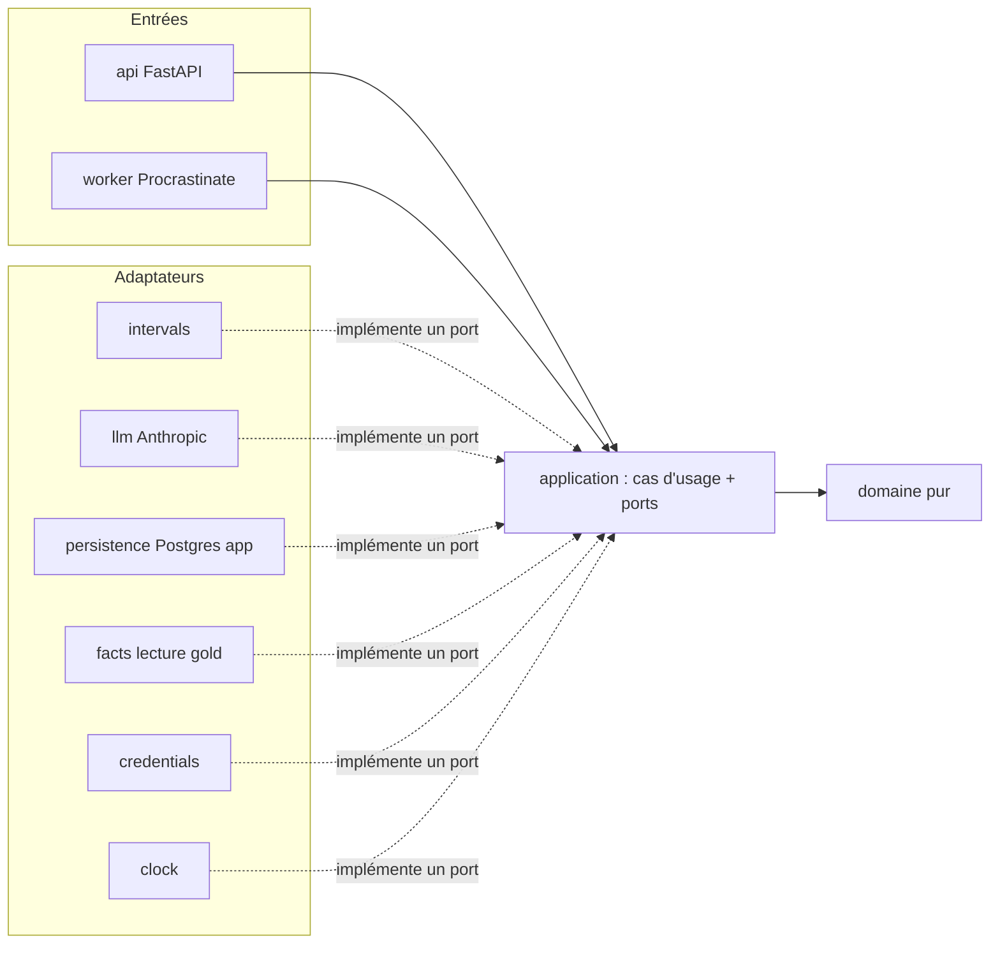
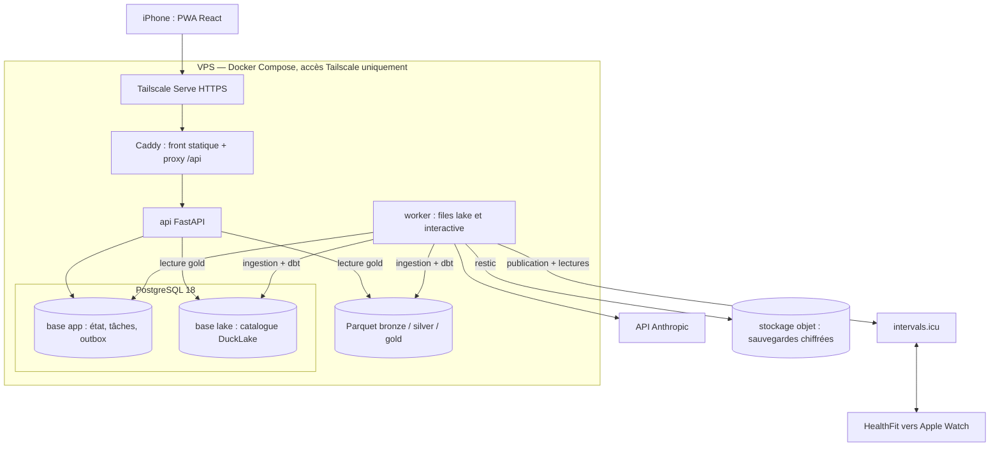
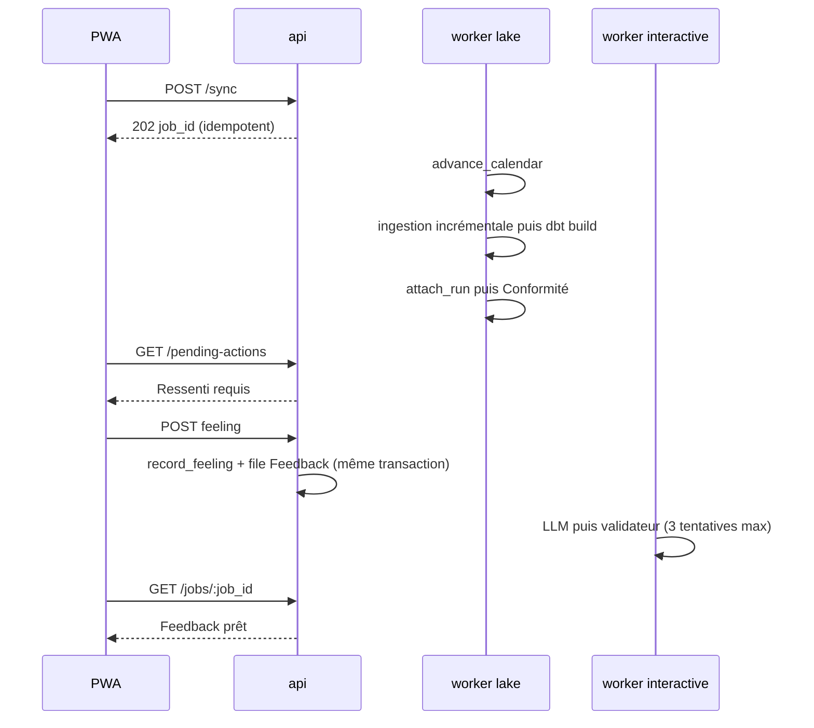
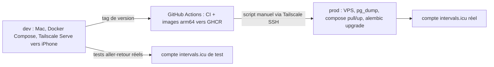
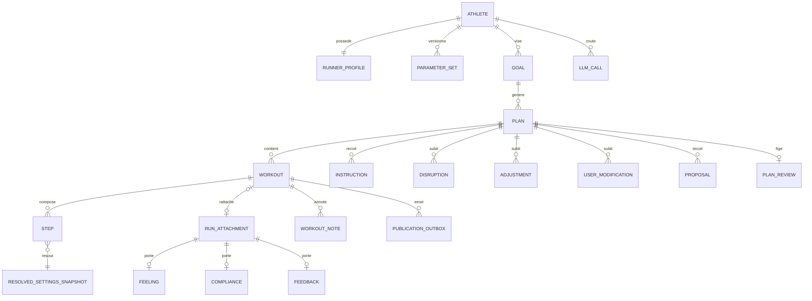

# Architecture Spine — running

## Design Paradigm

**Monolithe modulaire à cœur hexagonal, adossé à un lakehouse ELT medallion.**

- **Backend** : un seul programme Python, une seule image Docker, deux processus (`api`, `worker`). Le **domaine** est pur (aucune I/O) et contient toutes les règles du PRD. Il atteint le monde extérieur par des **ports**, implémentés par des **adaptateurs**.
- **Données** : deux natures.
  - L'**état de l'app**, c'est-à-dire ce que l'utilisateur ou l'app écrit, vit dans Postgres, base `app`.
  - Les **faits** lus dans intervals.icu vivent dans DuckLake : un catalogue Postgres (base `lake`) et des fichiers Parquet. Ils passent par `bronze` → `silver` → `gold`, et DuckDB sert de moteur de calcul sans état, piloté par dbt.
- **Front** : une PWA React mince, sans aucune règle métier.

| Couche | Répertoire | Contenu |
| --- | --- | --- |
| Domaine | `backend/src/running/domain/` | Machines à états, garde-fous, Conformité, Matrice, Imprévus, rattachement, VDOT, constructeur de Blocs, Bilan, validateur et extracteur de nombres des sorties LLM |
| Application | `backend/src/running/application/` | Cas d'usage (commandes et requêtes), définitions des ports (`Calendar`, `Facts`, `Llm`, `Repository`, `Credentials`, `Clock`) |
| Adaptateurs | `backend/src/running/adapters/` | `intervals/` (publication et ingestion EL), `llm/`, `persistence/` (base `app`), `facts/` (lecture de `gold`), `credentials/`, `clock/` |
| Entrées | `backend/src/running/api/`, `backend/src/running/worker/` | Routeurs FastAPI, tâches Procrastinate |
| Transformation | `data/dbt/` | Modèles et tests bronze, silver et gold |
| Présentation | `frontend/` | PWA React et client API généré |



## Invariants & Rules

### AD-1 — Sens des dépendances hexagonal

- **Binds:** all
- **Prevents:** un domaine qui appelle directement intervals.icu, Postgres ou le LLM, et devient intestable sans réseau ; un transport vers la montre non remplaçable (principe 6).
- **Rule:** les dépendances vont dans un seul sens :
  - `domain/` n'importe que la bibliothèque standard et lui-même ;
  - `application/` dépend de `domain/` et définit les ports ;
  - `adapters/`, `api/` et `worker/` dépendent de `application/` et de `domain/`, jamais l'inverse.

  Aucun SDK tiers (intervals.icu, `anthropic`, SQLAlchemy, DuckDB, Procrastinate) n'est importé hors de `adapters/` et `worker/`. Une règle d'import vérifiée en CI fait respecter ce sens.

### AD-2 — Deux magasins, une frontière en lecture seule

- **Binds:** FR-1, FR-3, FR-8, FR-11, FR-13, NFR-3, NFR-6
- **Prevents:** un même fait écrit à deux endroits ; un état métier « raffiné » par un pipeline ; un `dbt run` qui écrase une donnée de l'utilisateur ; un cycle entre `app` et `gold`.
- **Rule:**
  - **Base `app`** : tout l'état écrit par l'utilisateur ou l'app. Elle ne change que selon AD-4.
  - **Lake** : uniquement les faits d'intervals.icu et leurs dérivés. Seule l'ingestion (EL, worker) écrit `bronze`, et seul dbt écrit `silver` et `gold`. L'ingestion couvre :
    - les activités et leurs laps ;
    - les **streams FC et allure** ;
    - le wellness (FC au repos) ;
    - la CTL ;
    - les réglages de sport : zones et seuils.
  - **Lectures croisées** :
    - l'app lit uniquement les modèles `gold` marqués comme interface, via le port `Facts` ;
    - dbt lit `app` en lecture seule, **en un seul instantané par exécution**, et seulement des faits saisis (`feeling`, `run_attachment`, Séances prévues) ;
    - aucun modèle `gold` ne dépend d'un résultat de domaine qui lui-même dépend de `gold`.
  - **Rôles Postgres distincts** (`app_rw`, `dbt_ro_app`, `lake_rw`) : la lecture seule est imposée par les droits, pas seulement par convention.

  Le tableau ci-dessous fixe le propriétaire de chaque entité.

| Entité (nom dans le code) | Propriétaire / magasin |
| --- | --- |
| `athlete`, `runner_profile` (blessures, disponibilités, jour de sortie longue, indisponibilités, fuseau, emplacements nutrition et sommeil vides) | `app` |
| `goal` (inclut `race_event`), `plan`, `workout`, `step`, `instruction` (Consigne) | `app` |
| `disruption` (Imprévu), `adjustment`, `user_modification`, `proposal` | `app` |
| `run_attachment`, `feeling`, `compliance`, `feedback`, `workout_note` (exclue de dbt et du LLM) | `app` |
| `plan_review` (Bilan de fin de Plan, figé — AD-24) | `app` |
| `parameter_set`, `llm_call`, `publication_outbox`, `sync_status`, `resolved_settings_snapshot` | `app` |
| Courses, laps, streams, FC au repos, CTL, zones et seuils, séries journalières (plus longue Course, volume, meilleur effort) | lake (`gold`) |

La `method` est une liste fermée définie dans le code ; le Plan la référence par son code.

### AD-3 — Un seul propriétaire par calcul

- **Binds:** FR-4, FR-5, FR-8, FR-13, FR-14, FR-15, FR-16, FR-22, NFR-3
- **Prevents:** la même règle écrite en Python et en SQL, qui finit par diverger.
- **Rule:**
  - **Domaine (fonctions Python pures)** : Conformité, « Tes données », Matrice, Seuil de surmenage, garde-fous FR-5 et FR-22, VDOT et chrono irréaliste, Bilan de fin de Plan.
  - **dbt (`gold`)** : uniquement des **faits et séries brutes, sans aucun paramètre métier**. Par exemple, la plus longue Course par jour local, le volume par jour, le meilleur effort par distance et par date, les laps avec le temps passé par zone FC calculé depuis les streams, et les tendances de CTL et de FC au repos.
  - **Fenêtres et seuils** (30 jours, 7 jours, 6 mois, +5 bpm) : appliqués uniquement par le domaine sur ces séries, avec les valeurs de `parameter_set`.
  - **Contrôle** : chaque calcul a exactement un test qui le recalcule (NFR-8).

### AD-4 — Un seul chemin pour modifier l'état

- **Binds:** FR-5, FR-6, FR-7, FR-11, FR-17, FR-18, FR-19, FR-22
- **Prevents:** un écran ou une tâche qui écrit directement en base et contourne les garde-fous ; une proposition confirmée sur un Plan qui a changé entre-temps ; deux écritures concurrentes sur le même Plan.
- **Rule:** toute modification de `app` passe par un cas d'usage de `application/`, dans **une transaction Postgres**.
  - Un cas d'usage qui touche un Plan ou ses Séances commence par `SELECT … FOR UPDATE` sur la ligne `plan`, incrémente `plan.version`, puis revérifie les garde-fous (AD-12) **avant** le commit.
  - Une `proposal` (FR-16, FR-17, demande à l'IA) enregistre la `plan.version` sur laquelle elle a été calculée. À la confirmation, elle est rejetée si la version a changé et qu'elle ne passe plus les garde-fous.
  - Une proposition **expire** à la fin du jour local où elle a été faite.
  - Les transitions d'état passent uniquement par les machines à états de AD-21.

### AD-5 — Publication via une outbox transactionnelle

- **Binds:** FR-7, FR-9, FR-10, FR-17, FR-19, FR-22, NFR-7, SM-7
- **Prevents:** une modification perdue quand intervals.icu échoue ; des doublons dans le calendrier ; une Séance déplacée supprimée par erreur ; deux chemins d'écriture vers intervals.icu.
- **Rule:**
  - **Enregistrement.** Un cas d'usage qui crée, modifie, déplace ou annule des Séances publiées écrit dans la **même transaction** une ligne `publication_outbox`. Cette ligne contient une **référence** (`workout_id`, opération `upsert` ou `delete`), jamais une copie du contenu.
  - **Publication.** Le worker regroupe les lignes en attente de chaque Séance, relit son état courant et le publie, une Séance à la fois. Un **déplacement est un simple upsert** : la Séance garde son `external_id`, qui est son UUID stable. Une Séance annulée, ou les Séances à venir d'un Plan annulé ou suspendu, produisent un `delete`.
  - **Échec.** Un échec n'annule jamais la modification. Il passe le volet publication de `sync_status` à ⚠️, avec un code de cause.
  - **« Resynchroniser ».** Ce bouton remet en file toutes les Séances à venir du Plan actif.
  - **Exclusivité.** La Publication est la **seule** écriture vers intervals.icu, et elle ne passe que par l'outbox. Le mécanisme exact d'upsert et de suppression (clé API ou OAuth, `external_id` ou `icu_event_id` stocké) est fixé par le spike OQ-1.

### AD-6 — Tâches longues, deux files, sérialisation du lake

- **Binds:** FR-1, FR-5, FR-11, FR-14, NFR-9
- **Prevents:** une génération de 2 min qui meurt avec une requête HTTP ; deux écritures DuckLake concurrentes ; un Feedback coincé derrière un `dbt build` ou une génération de Plan ; une pile de synchros lancées par des tirer-pour-rafraîchir successifs.
- **Rule:** toute opération qui peut durer plus d'environ 1 s est une tâche **Procrastinate**, exécutée par le `worker`. L'`api` répond `202` + `job_id`, puis `GET /jobs/:job_id` renvoie le statut, les **étapes à progression monotone** et le résultat. Deux files :
  - **`lake`** (concurrence 1, verrou `lake`) : synchro complète, c'est-à-dire `advance_calendar` (AD-20), ingestion incrémentale, `dbt build` limité aux modèles touchés, puis détection et rattachement (AD-22), et publications. `POST /sync` est **idempotent** (`queueing_lock`) : il renvoie le `job_id` de la synchro en cours ou en attente.
  - **`interactive`** (concurrence ≥ 2, ne prend jamais le verrou `lake`, lit `gold` en lecture seule) : Feedback, génération de Plan, demande à l'IA.

  Pas de websocket ni de push : le front interroge l'état. Les tâches LLM ne sont pas relancées automatiquement par Procrastinate. Leurs tentatives sont gérées par le domaine (AD-7). Une tâche interrompue repart de sa dernière étape enregistrée.

### AD-7 — Le LLM propose, le domaine valide

- **Binds:** FR-5, FR-6, FR-14, FR-19, FR-22, NFR-2, NFR-4, NFR-5, SM-5
- **Prevents:** un chiffre inventé affiché ; un Plan non validé publié ; un coût non mesuré ; une fuite des notes personnelles ; deux façons différentes de reconnaître un nombre dans un texte.
- **Rule:** tout appel au LLM passe par le port `Llm`.
  - **Sortie structurée systématique** (`output_config.format`) :
    - Plan : squelette (AD-9) ;
    - Feedback : `{strength, improvement, consequence}` ;
    - demande à l'IA : liste de modifications.
  - **Validation avant persistance.** Le domaine valide toute sortie avant de l'enregistrer.
  - **Ce que le LLM ne produit jamais** : une valeur d'allure ou de FC (AD-8), un Bloc (AD-9), un verdict de garde-fou, ou un nombre absent des faits qui lui ont été fournis.
  - **Extracteur de nombres.** Il est **unique**, dans le domaine, et normalise allures, durées, écarts et pourcentages. Il alimente le validateur de FR-14.
  - **Tentatives.** 3 au plus par cycle, et un refus du modèle compte comme une tentative échouée.
  - **Journal.** Chaque appel écrit une ligne `llm_call` : usage, modèle, effort, tokens, coût, tentative et `job_id`.
  - **Données exclues du prompt.** Les **`workout_note` n'entrent jamais dans un prompt**. Les **blessures** sont transmises avec l'obligation de justifier chaque Séance concernée (AD-12).
  - **Réglages par usage** (`plan`, `feedback`, `ai_edit`) : modèle, effort (**toujours explicite**) et budget de temps. Valeur par défaut : `claude-opus-5-5`.

### AD-8 — Les cibles sont des références résolues par le code

- **Binds:** FR-5, FR-9, FR-13, FR-22
- **Prevents:** des allures « hallucinées » ; une Conformité calculée contre une cible impossible à reproduire ; deux sources pour la même allure.
- **Rule:**
  - **Référence.** Une cible de Bloc est une **référence** : une zone parmi les 5 zones d'intervals.icu, ou une allure Daniels E, T, I, R ou M.
  - **Résolution.** Le domaine la convertit en valeur absolue en lisant les **zones et le seuil d'intervals.icu** (lus dans `gold`), seule source pour toutes les références, Daniels compris, au moyen d'une table de correspondance paramétrée. La VDOT ne sert qu'à l'alerte de chrono (AD-13).
  - **Instantané.** Chaque résolution enregistre le `resolved_settings_snapshot` utilisé.
  - **Stockage.** Le `step` garde la référence, la valeur résolue et l'identifiant de l'instantané.
  - **Conformité.** Elle compare toujours le réalisé à la valeur résolue stockée.

### AD-9 — Squelette produit par le LLM, Blocs construits par le code

- **Binds:** FR-5, FR-9, FR-22, NFR-4, NFR-9
- **Prevents:** une génération trop lente ou trop chère ; deux façons de construire les Blocs selon l'origine de la Séance.
- **Rule:**
  - **Squelette.** Pour chaque Séance, le LLM produit seulement `{date, type, volume, intensity_ref, justification}`.
  - **Constructeur unique.** Les Blocs sont construits par **un seul constructeur déterministe par type de Séance**, le même pour la génération, la modification à la main et la demande à l'IA.
  - **Ciblage (FR-9).** Allure pour fractionné, tempo, seuil et allure de course ; FC pour tous les autres types.
  - **Traduction.** Le passage à la syntaxe `description` d'intervals.icu est une fonction déterministe unique, testée par un aller-retour.

### AD-10 — Généricité : aucune logique liée à une distance ou à un Objectif

- **Binds:** all
- **Prevents:** des branches `if marathon` qui figent le produit sur un Objectif, en v1 comme dans les versions suivantes.
- **Rule:** aucune règle du code ne dépend d'une distance, d'une Épreuve ou d'un Objectif particulier. Toutes les distances suivent les mêmes règles. Un comportement qui varie selon la distance est un **paramètre** (AD-11), jamais une branche.

### AD-11 — Paramètres versionnés par athlète

- **Binds:** FR-4, FR-5, FR-13, FR-14, FR-16, NFR-3, NFR-4
- **Prevents:** un recalibrage qui demande un redéploiement ; un Feedback passé impossible à recalculer ; un Plan existant que l'on revérifie avec des seuils différents de ceux qui l'ont produit.
- **Rule:**
  - **Où vivent les valeurs.** Toutes les valeurs ajustables sont dans un `parameter_set` versionné et immuable, propre à l'athlète. Cela couvre :
    - tolérances de Conformité, Seuil de surmenage, garde-fous et fenêtres, bandes des Méthodes ;
    - correspondance des allures Daniels avec les zones, heuristique VDOT ;
    - modèle, effort et budget de temps du LLM ;
    - budget IA, seuil d'alerte à 80 % et taux €/$.
  - **Valeurs par défaut.** Elles sont écrites dans le code. Toute modification crée une nouvelle version.
  - **Version utilisée.** Chaque `plan`, `compliance`, `feedback` et `plan_review` enregistre la version qu'il a utilisée. La version **courante** sert pour une génération ou un nouveau calcul. Pour revérifier les garde-fous d'un Plan existant (FR-22), on reprend la version **épinglée par ce Plan**.
  - **Exclusion de dbt.** dbt ne lit jamais `parameter_set` (AD-3).

### AD-12 — Garde-fous : définitions et familles

- **Binds:** FR-4, FR-5, FR-16, FR-22
- **Prevents:** deux epics qui définissent différemment la « semaine », la « semaine allégée », la « bande de la Méthode » ou ce qui est contournable.
- **Rule:** chaque garde-fou a un `id` stable et une famille.
  - **Calendrier évalué.** Semaines **ISO, du lundi au dimanche, dans le fuseau de l'athlète**. Volume mesuré en **distance (m)**. On évalue en mémoire un **calendrier unifié** : le réalisé pour les jours passés (séries `gold`), le prévu pour les jours à venir (Plan candidat).
  - **Sécurité physique** : infranchissable pour toute hausse de risque.
    - Volume hebdomadaire ≤ +10 % par rapport à la **dernière semaine non allégée**.
    - Une semaine allégée toutes les 3 ou 4 semaines. Elle est définie par un volume ≤ 75 % de celui de la dernière semaine non allégée.
    - Distance d'une Séance ≤ 110 % de la plus longue Course ou Séance planifiée sur 30 jours glissants.
    - Bande d'intensité de la Méthode, en temps prévu par zone :
      - 80/20 : Z1-Z2 ≥ 75 % ;
      - polarisé : Z1-Z2 ≥ 75 %, Z3 ≤ 10 %, Z4-Z5 ≥ 10 % ;
      - Daniels : la majorité du volume en allure E, avec T ≤ 10 %, I ≤ 8 % et R ≤ 5 % du volume hebdomadaire.
    - Pendant 7 jours après un allègement de surmenage, **toute hausse manuelle d'une Séance allégée** est refusée.
  - **Modification de l'utilisateur.** On compare l'état avant et après la modification. Elle n'est refusée que si elle **crée ou aggrave** une violation de sécurité **en augmentant** la charge. Une réduction n'est jamais refusée.
  - **Préférences du Profil** : contournables ponctuellement par une modification de l'utilisateur, sans changer le Profil, et toujours respectées par les Plans générés. Ce sont les disponibilités, le jour de la sortie longue et les périodes d'indisponibilité.
  - **Blessures en v1** : aucun garde-fou déterministe. Le LLM les reçoit et justifie chaque Séance concernée. Une blessure sérieuse passe par l'Imprévu « Blessé », qui suspend le Plan. Le modèle de données réserve la place des contraintes structurées pour la v1.1.
  - **Résultat** : `{refused: [{id, code, params, message}], informational: [...]}`. Le message en français est produit par le backend, qui en est la seule source. Les garde-fous s'exécutent aussi **à blanc** (`dry_run`), pour que le front désactive « Enregistrer » et grise les jours interdits sans dupliquer la règle.

### AD-13 — Chrono irréaliste

- **Binds:** FR-4
- **Prevents:** une alerte calculée différemment selon l'écran ou la distance.
- **Rule:**
  - **Condition d'alerte** : la **VDOT requise** par le chrono visé dépasse **la VDOT actuelle + min(semaines du Plan ÷ 5 ; 4)**.
  - **VDOT actuelle** : elle vient du meilleur effort des 6 derniers mois, tiré de la série `gold` des meilleurs efforts.
  - **Calcul** : même formule de Daniels pour toutes les distances (AD-10).
  - **Paramètres** : 5 et 4 sont réglables (AD-11).
  - **Non bloquante** : elle passe par `POST /goals:check`, sans rien enregistrer.

### AD-14 — Temps : dates locales, fuseau de l'athlète

- **Binds:** FR-7, FR-11, FR-12, FR-16, FR-18, FR-22
- **Prevents:** une Course de 23 h 30 rattachée au lendemain ; une Séance marquée manquée trop tôt ; des Ressentis traités dans le mauvais ordre.
- **Rule:**
  - **Séance.** Elle a une **date locale** (`DATE`), sans heure.
  - **Course.** Elle porte `started_at` (`timestamptz`) et sa date locale, calculée dans le fuseau de l'athlète.
  - **Horodatages techniques.** Ils sont en UTC.
  - **Règles liées au jour.** Toutes se calculent dans le fuseau stocké dans le Profil, par une seule fonction du domaine. Le jour courant vient **uniquement** du port `Clock` (AD-20).
  - **Ordre.** Les Ressentis en attente et la série de 3 🥵 (FR-16) suivent l'ordre de `started_at`.

### AD-15 — Ingestion idempotente

- **Binds:** FR-1, FR-11, FR-12, NFR-7
- **Prevents:** une activité comptée deux fois ; des centaines de Ressentis demandés pour l'historique importé ; un dépassement de quota sans repli.
- **Rule:**
  - **`bronze`** : ajout seul, avec le JSON brut, l'identifiant intervals.icu et `fetched_at`.
  - **`silver`** : déduplique par identifiant d'activité et garde la dernière version. Une activité supprimée dans intervals.icu est marquée `source_deleted`. Son rattachement et son Ressenti sont conservés, et rien n'est recalculé.
  - **Courses concernées.** Seules les Courses dont `started_at` est **postérieur à la première validation du Profil** entrent dans le cycle Ressenti et Feedback. L'historique importé sert de faits uniquement.
  - **Quotas.** Un limiteur unique dans l'adaptateur impose un plafond local (environ 8 requêtes/s) et un backoff exponentiel sur les réponses 429 et 5xx, sans dépendre d'un en-tête de quota.

### AD-16 — Multi-athlète latent

- **Binds:** NFR-6
- **Prevents:** un identifiant figé dans le code, qui empêcherait d'ajouter un deuxième Profil.
- **Rule:**
  - **`athlete_id`.** Toute table d'`app` le porte, ainsi que toute table du lake qui contient des données d'athlète.
  - **Identifiants externes.** Ceux d'intervals.icu et la clé du LLM sont lus via le port `Credentials`, par athlète. En v1, ce port lit des variables d'environnement.
  - **Aucun identifiant d'athlète en dur** dans le code.
  - **Authentification.** Il n'y en a pas en v1 : l'API résout un athlète unique, configuré au démarrage.

### AD-17 — Réseau et confidentialité

- **Binds:** NFR-1, NFR-2
- **Prevents:** une exposition publique ; une clé dans le bundle du front ; des données personnelles lisibles chez un tiers non prévu.
- **Rule:**
  - **Aucune exposition sur Internet.** La seule entrée est Tailscale Serve (HTTPS du tailnet, MagicDNS, nom de machine neutre), qui transmet à Caddy.
  - **Clés.** Elles n'existent que dans l'environnement du backend.
  - **Front.** Il n'appelle que l'`api`.
  - **Tiers destinataires.** Les seuls qui reçoivent des données **en clair** sont intervals.icu et Anthropic.
  - **Sauvegardes.** Elles sont **chiffrées sur le VPS avant leur envoi** (restic), et la clé est conservée hors du fournisseur de stockage. Le fournisseur ne voit donc qu'un chiffré. NFR-2 doit être amendé dans ce sens.

### AD-18 — Contrat front / back

- **Binds:** FR-10, FR-12, FR-20, FR-21, all UI
- **Prevents:** des types d'API recopiés à la main ; une règle métier dupliquée dans le front ; un format d'erreur différent selon l'écran ; une sheet ouverte deux fois ou dans le désordre.
- **Rule:**
  - **Client généré.** OpenAPI (FastAPI) est l'unique source du contrat. Le client TypeScript est **généré** et vérifié en CI : une régénération ne doit produire aucun diff.
  - **Front sans règles.** Il ne contient aucune règle métier. Chaque Séance arrive avec un **`display_state` calculé par le domaine** (à venir, en attente de la course, réalisée, manquée, annulée), accompagné des actions permises et des jours sélectionnables.
  - **`GET /pending-actions`.** Il renvoie, **dans l'ordre**, les actions qui bloquent l'écran : Ressentis (ordre de `started_at`), puis confirmations de rattachement, puis propositions. Le front affiche une seule sheet à la fois, dans cet ordre.
  - **`sync_status`.** Il a deux volets, publication et ingestion, chacun avec un code de cause.
  - **Erreurs.** Elles suivent RFC 9457 avec un `code` stable.
  - **Hors ligne.** Le front affiche la dernière réponse GET en cache, avec sa date, **en lecture seule**. Aucune mutation n'est mise en file, et aucune sheet bloquante ne s'ouvre depuis le cache.

### AD-19 — Porte de mise en usage

- **Binds:** NFR-8, SM-1..SM-6
- **Prevents:** une version instable en usage ; un chiffre affiché sans test ; un test de contrat qui pollue le vrai calendrier ; un budget de latence jamais mesuré.
- **Rule:** les conditions suivantes doivent toutes être remplies.
  - **Déploiement.** Seul un **tag avec une CI verte** est déployé.
  - **Stories.** Une story n'est terminée qu'avec ses tests, et chaque chiffre affiché a un test qui le recalcule.
  - **Contrats intervals.icu.** Chaque appel a un test de contrat (fixtures en CI) et un **aller-retour réel sur le compte intervals.icu de test**. Le compte réel ne sert qu'à la prod.
  - **LLM en CI.** Aucun appel réel : un faux adaptateur à réponses enregistrées le remplace.
  - **Avant la première mise en usage** : une restauration de sauvegarde réussie, et les budgets NFR-9 mesurés sur le VPS (Feedback < 30 s, Plan < 2 min).

### AD-20 — Horloge et transitions temporelles

- **Binds:** FR-7, FR-8, FR-11, FR-18, SM-6
- **Prevents:** une epic qui marque « manquée » par une tâche nocturne pendant qu'une autre la calcule à la lecture ; l'heure UTC du serveur utilisée à la place du fuseau ; un Plan terminé dont le Bilan n'existe pas.
- **Rule:**
  - **Port `Clock`.** C'est la seule source de l'instant et du jour local. Tout appel à `now()` ou `today()` en dehors de ce port est interdit, et la CI le vérifie.
  - **`advance_calendar`.** Ce cas d'usage unique et idempotent applique toutes les transitions dues au temps (Séance *manquée*, Plan *terminé*, expiration des propositions) en passant par AD-21. Il est lancé **en tête de chaque synchro** et par une **tâche Procrastinate quotidienne**, à 03:00 heure locale de l'athlète.
  - **États stockés et état affiché.** Les états *manquée* et *terminé* sont **stockés**. « En attente de la course » est un état d'affichage, déduit de la date.

### AD-21 — Machines à états normatives

- **Binds:** FR-5, FR-6, FR-7, FR-12, FR-14, FR-17, FR-18, FR-19
- **Prevents:** des transitions inventées séparément par chaque epic, par exemple un « Reprendre » qui crée un nouveau Plan et laisse des doublons dans intervals.icu.
- **Rule:** seules les transitions ci-dessous existent. Leurs effets se produisent dans la même transaction (AD-4, AD-5). Un index unique garantit **au plus un Plan *actif* ou *suspendu*** et **au plus un Plan *proposé*** par athlète.

| Machine | Source → cible | Déclencheur | Effets |
| --- | --- | --- | --- |
| Plan | — → *proposé* | génération validée | remplace le *proposé* précédent (supprimé) |
| Plan | *proposé* → *proposé* | refus avec Consigne | nouvelle version régénérée ; la Consigne est conservée |
| Plan | *proposé* → *actif* | acceptation | l'ancien Plan *actif* ou *suspendu* passe *annulé* ; outbox `upsert` de toutes les Séances |
| Plan | *actif* → *suspendu* | Imprévu « Blessé » | Séances à venir → *annulée* ; outbox `delete` |
| Plan | *suspendu* → *actif* | « Reprendre » | **même Plan** ; Séances régénérées à partir de la date du jour (FR-5) ; outbox `upsert` |
| Plan | *actif* ou *suspendu* → *annulé* | « Arrêter » ou nouveau Plan accepté | Séances à venir → *annulée* ; outbox `delete` ; Bilan figé (AD-24) |
| Plan | *actif* → *terminé* | `advance_calendar`, lendemain de la dernière Séance | Bilan figé (AD-24) |
| Séance | *à venir* → *réalisée* | `attach_run` (AD-22) | Conformité calculée |
| Séance | *à venir* → *manquée* | `advance_calendar`, lendemain, Plan *actif* | — |
| Séance | *manquée* → *réalisée* | rattachement tardif, tant que le Plan est *actif* | Conformité calculée |
| Séance | *à venir* → *annulée* | Imprévu, Ajustement, suspension ou annulation du Plan | outbox `delete` |
| Feedback | — → *en attente du Ressenti* | rattachement d'une Course éligible (AD-15) | — |
| Feedback | *en attente du Ressenti* → *en génération* | `record_feeling` | tâche Feedback mise en file dans la même transaction |
| Feedback | *en génération* → *prêt* ou *en erreur* | fin du cycle de 3 tentatives | — |
| Feedback | *en erreur* → *arrêté* | « Arrêter l'analyse » | état « avis indisponible » |
| Feedback | *en erreur* ou *arrêté* → *en génération* | « Relancer », `relaunch_count < 2`, Plan *actif* | `relaunch_count` + 1 |

### AD-22 — Rattachement unique

- **Binds:** FR-11, FR-12, FR-13, FR-22
- **Prevents:** la détection (worker) et un déplacement (api) qui se croisent ; une Séance rattachée de nouveau après la pose du Ressenti ; une Conformité calculée deux fois.
- **Rule:**
  - **Cas d'usage unique.** Le seul cas d'usage qui écrit `run_attachment` est `attach_run`, sous le verrou du Plan (AD-4).
  - **Unicité.** Une contrainte d'unicité porte sur l'identifiant d'activité, et une unicité partielle sur `workout_id`.
  - **Statuts.** Un rattachement est `proposed`, `confirmed` ou `rejected`. Les cas veille et lendemain sont `proposed`, et se tranchent **avant** que le Ressenti soit demandé.
  - **Immuabilité.** Un rattachement devient immuable dès que le Ressenti est posé.
  - **Conformité.** Elle est calculée **une seule fois**, au passage à `confirmed`, et persistée avec une contrainte d'unicité. L'écran « Analyse en cours » l'affiche donc déjà.

### AD-23 — Porte du Ressenti

- **Binds:** FR-12, FR-14, FR-16
- **Prevents:** des chiffres de la Course visibles avant le Ressenti, sur n'importe quel écran ; un Ressenti modifié ; une tâche Feedback perdue.
- **Rule:**
  - **Porte côté API.** Tant qu'une Course éligible n'a pas de `feeling`, **aucun endpoint** ne renvoie ses chiffres (Conformité, Tes données, laps, streams) : ils répondent `409 FEELING_REQUIRED`. Un test d'intégration couvre tous les GET concernés.
  - **Ressenti.** `feeling` est en insertion seule et idempotent (une seule ligne par activité).
  - **Feedback.** `record_feeling` met en file la tâche Feedback **dans la même transaction** que l'enregistrement du Ressenti.

### AD-24 — Bilan de fin de Plan figé

- **Binds:** FR-5, FR-8, SM-6
- **Prevents:** un Plan suivant généré sans Bilan ou avec un Bilan périmé, ce qui ferait échouer SM-6 sans le signaler ; un Bilan qui change après coup.
- **Rule:**
  - **Calcul.** Le Bilan de fin de Plan est calculé par le **domaine** (AD-3), à partir des séries `gold` et de l'état `app`.
  - **Écriture.** Il est écrit en ligne **immuable** `plan_review`, dans la transaction qui fait passer le Plan à *terminé* ou *annulé*. Cette ligne enregistre aussi `parameter_set_id` et l'horodatage des faits utilisés.
  - **Synchro préalable.** La transition est toujours précédée d'une synchro (`advance_calendar` en tête de synchro). Pour une annulation demandée par l'utilisateur, la synchro est d'abord mise en file.
  - **Génération du Plan suivant.** Elle lit **obligatoirement** le dernier `plan_review` et le cite dans sa raison. Si le Plan est remplacé alors qu'il était encore *actif*, le Bilan est calculé à la date du jour (`as_of`).

### AD-25 — Opérations

- **Binds:** NFR-1, NFR-7, NFR-8
- **Prevents:** un accès à la prod coupé sans prévenir ; un lake qui grossit sans limite ; une sauvegarde incohérente ; une migration impossible à annuler.
- **Rule:**
  - **Tailscale.** La clé du nœud VPS est **sans expiration** (tag de serveur), et l'état de `tailscaled` est persistant.
  - **Sauvegarde.** Elle se fait chaque nuit **sous le verrou `lake`**, ce qui garantit un lot cohérent (base `app`, base `lake` et Parquet). Elle est chiffrée (AD-17) et conservée 30 jours. Un échec est visible dans `sync_status`.
  - **Maintenance DuckLake.** Chaque semaine, sous le verrou `lake`, on compacte et on expire les instantanés.
  - **Rétention.** `bronze` est conservé sans limite, car il est petit et c'est la source de reconstruction. Les tâches terminées et les logs sont gardés 90 jours, et `llm_call` sans limite.
  - **Migrations.** Alembic, uniquement vers l'avant. Un `pg_dump` précède chaque déploiement.
  - **Images.** Elles sont construites pour **arm64** et publiées sur GHCR. Les extensions DuckDB sont installées au moment de la construction.

## Consistency Conventions

| Concern | Convention |
| --- | --- |
| Langue | Code, schémas et API en **anglais**. Interface en français, au tutoiement (EXPERIENCE.md). Les messages des garde-fous sont produits par le backend (AD-12). |
| Glossaire → code (fixe) | Profil coureur `runner_profile` · Objectif `goal` · Épreuve `race_event` · Méthode `method` · Plan `plan` · Séance `workout` · Bloc `step` · Course `run` · Ressenti `feeling` · Conformité `compliance` · Feedback `feedback` · Matrice `state_matrix` · Seuil de surmenage `overload_threshold` · Imprévu `disruption` · Ajustement `adjustment` · Consigne `instruction` · Publication `publication` · Bilan de fin de Plan `plan_review` · Mes notes `workout_note` |
| Identifiants | UUID v7 générés par le backend. Les identifiants intervals.icu sont des références externes (`icu_*_id`), jamais des clés primaires. |
| Unités stockées | Entiers SI : m, s, s/km, bpm. La mise en forme se fait uniquement dans le front. |
| Argent | Coût IA en micro-USD (entier), affiché en € avec le taux de `parameter_set`. |
| Dates | `DATE` locale pour une Séance, `timestamptz` UTC ailleurs, ISO 8601 dans l'API (AD-14). |
| Semaines | Semaine ISO, du lundi au dimanche, dans le fuseau de l'athlète. « Semaine N du Plan » désigne la N-ième semaine ISO touchée par le Plan. |
| Erreurs | RFC 9457, avec un `code` stable en SCREAMING_SNAKE_CASE. |
| Opérations longues | `202` + `job_id`, puis `GET /jobs/:job_id` (AD-6). |
| Schémas de base | Alembic pour `app`, dbt pour `bronze`, `silver` et `gold`. Aucun des deux ne touche les tables de l'autre. |
| Nommage dbt | `bronze_<source>__<entité>`, `silver_<entité>`, `gold_<entité>`. Seuls les modèles `gold` dont `config.meta.interface` vaut `true` sont lus par l'app. Profil dbt : `threads: 1`. |
| Configuration | pydantic-settings, à partir de variables d'environnement. Les secrets restent hors du dépôt. |
| Logs | JSON structurés, avec `job_id` et `athlete_id`. Ni secret, ni note personnelle, ni prompt complet. |
| Outillage | `uv` (Python), `pnpm` (front), un seul dépôt. `duckdb` est épinglé explicitement dans `pyproject.toml`. |

## Stack

| Name | Version |
| --- | --- |
| Python | 3.14.10 |
| FastAPI | 0.165.0 |
| uvicorn | 0.54.0 |
| pydantic | 2.14.4 |
| pydantic-settings | 2.16.3 |
| SQLAlchemy | 2.1.9 |
| Alembic | 1.20.1 |
| psycopg | 3.3.9 |
| Procrastinate | 3.12.0 |
| anthropic (SDK Python) | 2.12.0 |
| Modèle LLM par défaut | claude-opus-5-5 |
| PostgreSQL | 18.7 |
| DuckDB (extension ducklake) | 1.5.6 |
| DuckLake (format) | 1.0 |
| dbt-core | 1.12.7 |
| dbt-duckdb | 1.11.1 |
| Node.js (LTS) | 26.13.1 |
| pnpm | 12.21.0 |
| TypeScript | 5.9.3 |
| React | 19.3.1 |
| Vite | 8.3.8 |
| @vitejs/plugin-react | 6.3.0 |
| vite-plugin-pwa | 2.0.0 |
| openapi-typescript | 7.13.0 |
| pytest | 9.2.0 |
| Vitest | 5.1.1 |
| Playwright | 1.65.1 |
| Caddy | 2.11.9 |
| restic | dernière version stable au déploiement |
| Tailscale | offre Personal (Serve) |
| Hébergement prod | VPS ARM 2 vCPU / 4 Go (type Hetzner CAX11) |

## Structural Seed

### Conteneurs et flux



### Synchro et Feedback



### Déploiement et environnements



- **Irremplaçable** : `app` et `lake`. **Reconstructible** : bronze (en réingérant) et silver/gold (par `dbt build`).
- Pas d'environnement intermédiaire : la CI et la porte de AD-19 en tiennent lieu.

### Entités principales (base app)



### Arborescence de départ

```text
running/
  backend/
    src/running/
      domain/        # règles pures, machines à états (AD-1, AD-3, AD-21)
      application/   # cas d'usage + ports
      adapters/      # intervals/, llm/, persistence/, facts/, credentials/, clock/
      api/           # FastAPI
      worker/        # tâches Procrastinate (files lake, interactive)
    migrations/      # Alembic (app)
    tests/           # unit/, contract/, integration/
  data/dbt/          # models/bronze|silver|gold, tests
  frontend/          # PWA React + client API généré
  deploy/            # compose.yaml, Caddyfile, scripts déploiement/sauvegarde/restauration
```

## Capability → Architecture Map

| Capability / Area | Lives in | Governed by |
| --- | --- | --- |
| FR-1 Import initial | file `lake` → `adapters/intervals` (EL) → dbt → `gold` | AD-2, AD-6, AD-15 |
| FR-2, FR-3 Profil coureur | `app.runner_profile` + séries `gold` | AD-2, AD-3, AD-16 |
| FR-4 Objectif, chrono irréaliste | `domain` (VDOT) + `POST /goals:check` | AD-10, AD-11, AD-13 |
| FR-5, FR-6 Génération et relecture | file `interactive` → `Llm` → validateur → constructeur de Blocs | AD-7, AD-8, AD-9, AD-12, AD-21, AD-24 |
| FR-7 Cycle de vie du Plan | machines à états du `domain` | AD-4, AD-5, AD-20, AD-21 |
| FR-8 Bilan de fin de Plan | `domain` → `app.plan_review` | AD-3, AD-24 |
| FR-9, FR-10 Publication et synchro | `publication_outbox` → file `lake` → intervals.icu ; `sync_status` | AD-5, AD-9, AD-18 |
| FR-11, FR-12 Détection et Ressenti | `attach_run`, `record_feeling`, `GET /pending-actions` | AD-14, AD-15, AD-22, AD-23 |
| FR-13, FR-14, FR-15 Conformité, Feedback, Matrice | `domain` + `Llm` → `compliance`, `feedback` | AD-3, AD-7, AD-8, AD-21, AD-22 |
| FR-16 Seuil de surmenage | `domain` + séries `gold` | AD-3, AD-11, AD-12, AD-14 |
| FR-17, FR-18, FR-19 Imprévus, Séances manquées, Ajustements | `domain` (arbre de décision, états) | AD-4, AD-5, AD-20, AD-21 |
| FR-22 Modifications | cas d'usage + garde-fous (`dry_run`) | AD-4, AD-9, AD-11, AD-12 |
| FR-20, FR-21 Accueil, détail | `frontend` + `display_state` | AD-18 |
| NFR-4 Coût IA | `llm_call` → Profil › coût IA | AD-7, AD-11 |
| NFR-1, NFR-2, NFR-7 Plateforme, confidentialité, dépendances | déploiement, adaptateurs | AD-1, AD-15, AD-17, AD-25 |
| NFR-6 Porte ouverte au partage | modèle de données | AD-16 |
| NFR-8 Solidité | CI, tests, porte | AD-19, AD-25 |
| NFR-9 Temps de réponse | file `interactive`, squelette produit par le LLM | AD-6, AD-9, AD-19 |

## Open Questions

- **OQ-1 — Publication intervals.icu avec une clé API (spike d’une demi-journée, première story de l’epic Publication).** Le spike vérifie sur le compte de test que `events/bulk?upsert=true` et la suppression par `external_id` fonctionnent avec une clé API. Selon la documentation, ces deux opérations sont réservées aux événements créés par la même application OAuth. Si elles échouent, deux replis possibles :
  - une application OAuth personnelle ;
  - stocker `icu_event_id` et cibler les mises à jour et suppressions par cet identifiant.

  AD-5 sera ajusté en conséquence.
- **OQ-2 — DuckLake et dbt-duckdb sur DuckDB 1.5.6 (spike d’une demi-journée, première story de l’epic Données).** Le spike tourne sur arm64 et Python 3.14. Il couvre : un attach `ducklake:postgres:`, l'installation des extensions au build de l'image, et un `dbt build` avec `threads: 1`. Repli : catalogue DuckLake en SQLite, ou montée en DuckDB 2.0.x avec un `pg_dump lake` préalable.
- **OQ-3 — Amendements du PRD à proposer.**
  - FR-5, FR-22 et §12 Q8 : blessures non déterministes en v1.
  - NFR-2 : sauvegardes chiffrées chez un fournisseur de stockage.
  - FR-8 : le Bilan est calculé à l'annulation sur la base des faits disponibles.
  - FR-12 : les Courses de l'historique importé n'entrent pas dans le cycle Ressenti.

## Deferred

- **Orchestrateur de données** (Dagster, Airflow, Kestra) : le worker suffit en v1. On pourra l'ajouter plus tard sans toucher au domaine.
- **Contraintes de blessure structurées** vérifiées par le code : prévues pour la v1.1. Leur place est réservée (AD-12).
- **Correction de prédiction propre à une distance** (par exemple Vickers & Vertosick pour le marathon) : si elle est ajoutée, ce sera sous forme de paramètre (AD-10).
- **DuckDB 2.0.x LTS / DuckLake 1.1** : à faire avant mars 2027, quand dbt-duckdb aura déclaré sa compatibilité. Migration irréversible, à précéder d'un `pg_dump lake`.
- **TypeScript 7** : quand openapi-typescript le prendra en charge.
- **Passage au cloud** : Postgres managé et Parquet sur S3/GCS ou MotherDuck. C'est un changement de configuration.
- **Valeurs par défaut de la correspondance allures Daniels / zones** : c'est un paramètre (AD-11), dont la valeur sera fixée dans la story du constructeur de Blocs.
- **Fournisseur de stockage objet** : n'importe quel fournisseur compatible S3, puisque les données y arrivent chiffrées.
- **Supervision avancée** (Prometheus, Grafana) : en v1, on s'appuie sur les logs JSON et `sync_status`.
- **Évaluation de la qualité des prompts** (SM-5) : manuelle, hors CI.
- **Authentification, comptes, stockage chiffré des identifiants en base** : seulement si un partage est envisagé (NFR-6).
- **Remplacement du transport vers la montre** (v2) : un nouvel adaptateur.
- **Nutrition et sommeil** (v3) : emplacements vides dans `runner_profile`.
