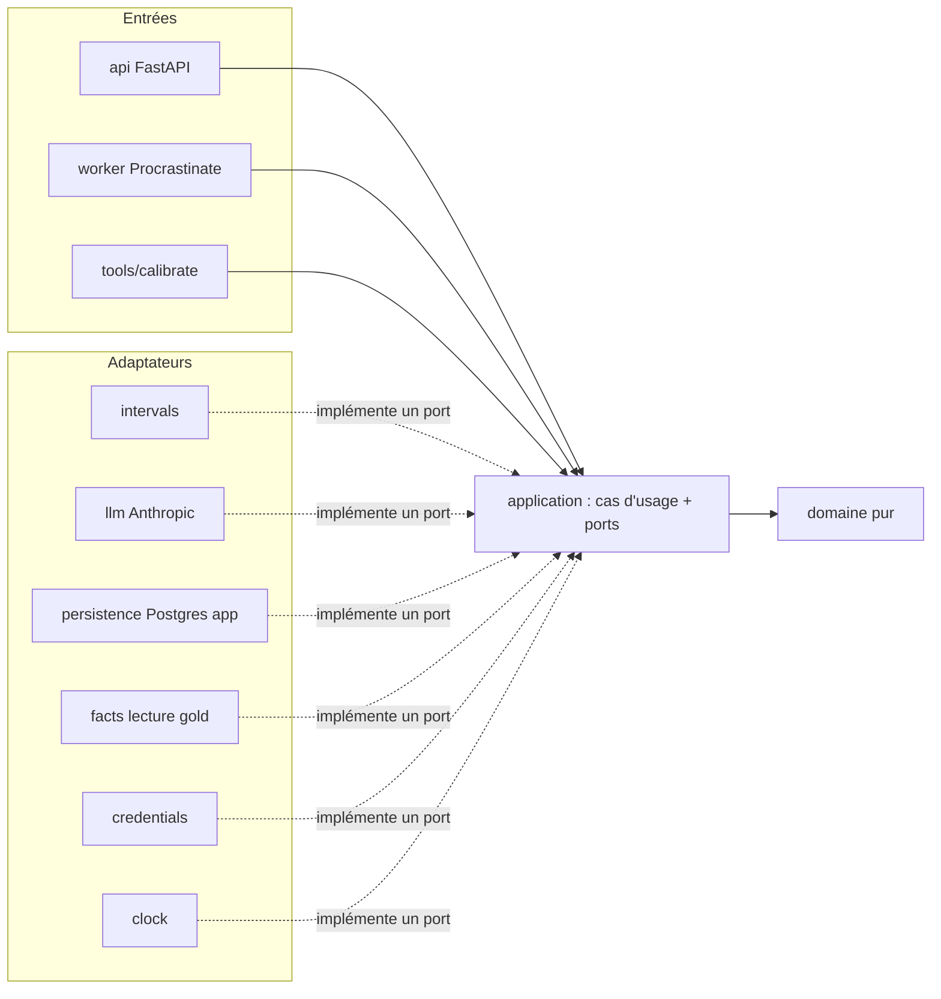
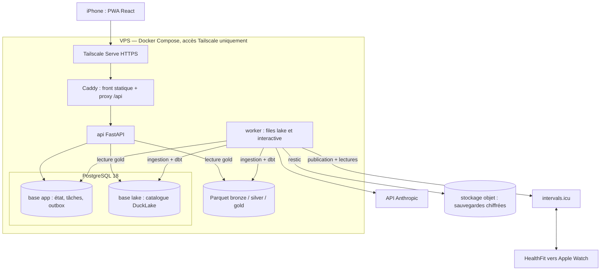
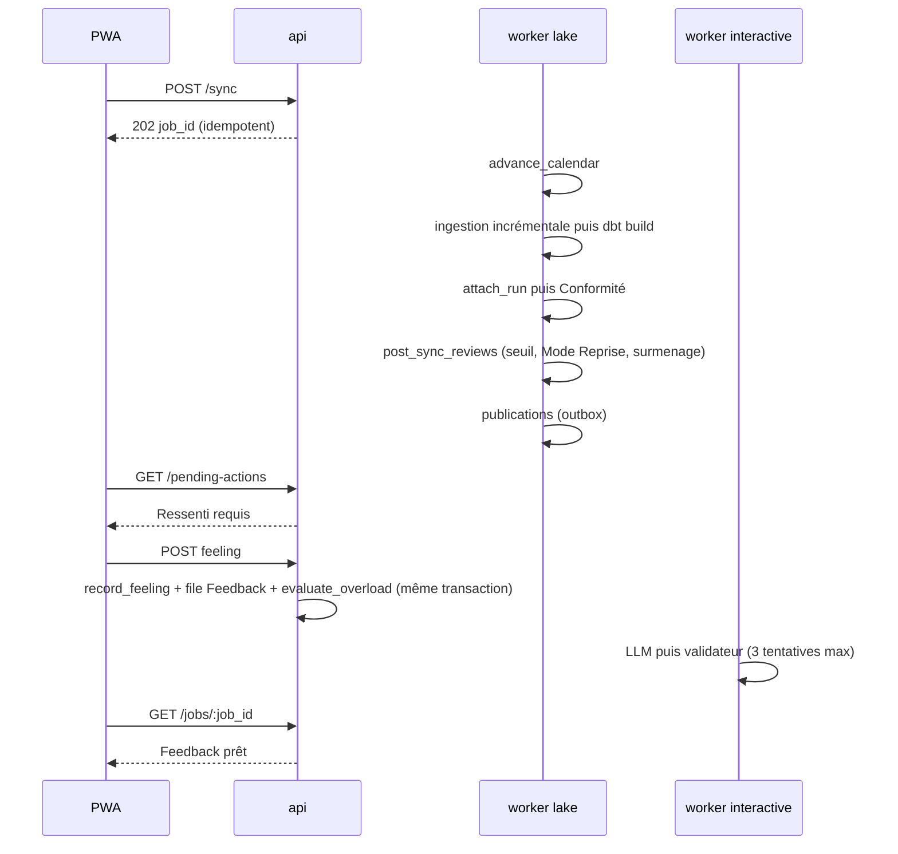
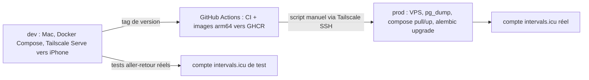
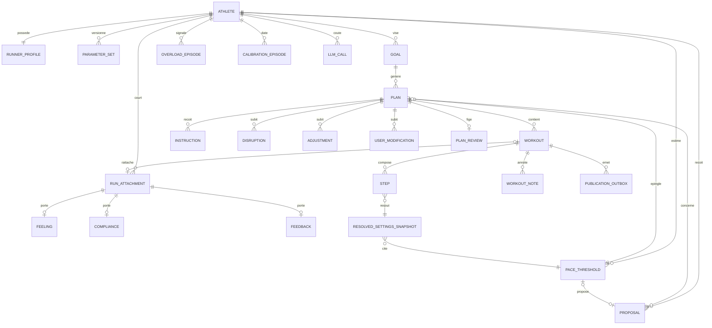

# Architecture Spine — running

## Design Paradigm

**Monolithe modulaire à cœur hexagonal, adossé à un lakehouse ELT medallion.**

- **Backend** : un seul programme Python, une seule image Docker, deux processus (`api`, `worker`). Le **domaine** est pur (aucune I/O) et contient toutes les règles du PRD. Il atteint le monde extérieur par des **ports**, implémentés par des **adaptateurs**.
- **Données** : deux natures.
  - L'**état de l'app**, c'est-à-dire ce que l'utilisateur ou l'app écrit, vit dans Postgres, base `app`.
  - Les **faits** lus dans intervals.icu vivent dans DuckLake : un catalogue Postgres (base `lake`) et des fichiers Parquet. Ils passent par `bronze` → `silver` → `gold`, et DuckDB sert de moteur de calcul sans état, piloté par dbt.
- **Front** : une PWA React mince, sans aucune règle métier.

| Couche | Répertoire | Contenu |
| --- | --- | --- |
| Domaine | `backend/src/running/domain/` | Machines à états, garde-fous, choix de la Méthode, Conformité, Matrice, détecteur de surmenage, Imprévus, rattachement, Seuil d'allure et zones d'allure, Mode Reprise, VDOT, constructeur de Blocs et sensations attendues, Bilan, gabarits de raisons, validateur et extracteur de nombres des sorties LLM |
| Application | `backend/src/running/application/` | Cas d'usage (commandes et requêtes), définitions des ports (`Calendar`, `Facts`, `Llm`, `Repository`, `Credentials`, `Clock`) |
| Adaptateurs | `backend/src/running/adapters/` | `intervals/` (publication et ingestion EL), `llm/`, `persistence/` (base `app`), `facts/` (lecture de `gold`), `credentials/`, `clock/` |
| Entrées | `backend/src/running/api/`, `backend/src/running/worker/`, `backend/tools/` | Routeurs FastAPI, tâches Procrastinate, outil `calibrate` |
| Transformation | `data/dbt/` | Modèles et tests bronze, silver et gold |
| Présentation | `frontend/` | PWA React et client API généré |



## Invariants & Rules

### AD-1 — Sens des dépendances hexagonal

- **Binds:** all
- **Prevents:** un domaine qui appelle directement intervals.icu, Postgres ou le LLM, et devient intestable sans réseau ; un transport vers la montre non remplaçable (principe 6) ; un outil qui écrit en base sans passer par les cas d'usage.
- **Rule:** les dépendances vont dans un seul sens :
  - `domain/` n'importe que la bibliothèque standard et lui-même (régressions et statistiques par le module `statistics`) ;
  - `application/` dépend de `domain/` et définit les ports ;
  - `adapters/`, `api/`, `worker/` et `tools/` dépendent de `application/` et de `domain/`, jamais l'inverse.

  Aucun SDK tiers (intervals.icu, `anthropic`, SQLAlchemy, DuckDB, Procrastinate) n'est importé hors de `adapters/` et `worker/`. La règle d'import est vérifiée en CI (import-linter).

### AD-2 — Deux magasins, une frontière en lecture seule

- **Binds:** FR-1, FR-3, FR-8, FR-11, FR-13, FR-16, NFR-3, NFR-6
- **Prevents:** un même fait écrit à deux endroits ; un état métier « raffiné » par un pipeline ; un `dbt run` qui écrase une donnée de l'utilisateur ; un cycle entre `app` et `gold`.
- **Rule:**
  - **Base `app`** : tout l'état écrit par l'utilisateur ou l'app. Elle ne change que selon AD-4.
  - **Lake** : uniquement les faits d'intervals.icu et leurs dérivés. Seule l'ingestion (EL, worker) écrit `bronze`, et seul dbt écrit `silver` et `gold`. L'ingestion couvre :
    - les activités, avec leur GAP moyenne, leur température météo moyenne, et leurs laps avec GAP par lap ;
    - les **streams FC, vitesse, GAP (si fournie) et altitude** ;
    - le wellness : FC au repos et **durée de sommeil** ;
    - la charge, la CTL et la Form ;
    - les réglages de sport : **zones FC**, FC seuil et `gap_model`. Le seuil et les zones d'allure d'intervals.icu ne sont jamais lus (AD-27).

    Ce que `silver` et `gold` n'extraient jamais est fixé par AD-26.
  - **Profondeur de l'import initial.** Tout l'historique disponible pour les activités et le wellness. Les streams sont limités à une profondeur paramétrée. L'import peut s'étaler sur plusieurs jours pour respecter les quotas : la progression reste visible, et `sync_status` ne passe pas en ⚠️ pour autant.
  - **Lectures croisées** :
    - l'app lit uniquement les modèles `gold` marqués comme interface, via le port `Facts` ;
    - dbt lit `app` en lecture seule, **en un seul instantané par exécution**, et seulement des faits saisis (`feeling`, `run_attachment`, Séances prévues) ;
    - aucun modèle `gold` ne dépend d'un résultat de domaine qui lui-même dépend de `gold`.
  - **Rôles Postgres distincts** (`app_rw`, `dbt_ro_app`, `lake_rw`) : la lecture seule est imposée par les droits, pas seulement par convention.

  Le tableau ci-dessous fixe le propriétaire de chaque entité.

| Entité (nom dans le code) | Propriétaire / magasin |
| --- | --- |
| `athlete`, `runner_profile` (blessures, disponibilités, jour de sortie longue, indisponibilités, fuseau, emplacement nutrition vide) | `app` |
| `pace_threshold` (Seuil d'allure versionné — AD-27) | `app` |
| `goal` (inclut `race_event`), `plan` (seuil épinglé, repères du Mode Reprise — AD-28), `workout`, `step`, `instruction` (Consigne) | `app` |
| `proposal` (athlète, Plan facultatif — AD-4), `disruption` (Imprévu), `adjustment`, `user_modification` | `app` |
| `run_attachment` (une ligne par Course éligible, `workout_id` facultatif), `feeling`, `compliance`, `feedback`, `workout_note` (exclue de dbt et du LLM) | `app` |
| `overload_episode`, `calibration_episode` (AD-29) | `app` |
| `plan_review` (Bilan de fin de Plan, figé — AD-24) | `app` |
| `parameter_set`, `llm_call`, `publication_outbox`, `sync_status`, `resolved_settings_snapshot` | `app` |
| Courses, laps, streams, FC au repos, durée de sommeil, charge, CTL, Form, zones FC, séries journalières (plus longue Course, volume, meilleur effort par distance en temps réel et en GAP) | lake (`gold`) |

La `method` est une liste fermée définie dans le code ; le Plan la référence par son code.

### AD-3 — Un seul propriétaire par calcul

- **Binds:** FR-4, FR-5, FR-8, FR-13, FR-14, FR-15, FR-16, FR-22, FR-23, FR-24, NFR-3
- **Prevents:** la même règle écrite en Python et en SQL, qui finit par diverger ; un outil de calibrage qui réécrit le détecteur à sa façon ; deux modèles de GAP dans une même série.
- **Rule:**
  - **Domaine (fonctions Python pures)** :
    - Conformité (temps en zone contre la plage résolue stockée, sur la fraction paramétrée), « Tes données », FC à allure comparable, découplage allure / FC, dérive cardiaque ;
    - Matrice, Seuil de surmenage, Lignes de base ;
    - garde-fous FR-5 et FR-22, choix de la Méthode, `planned_distance` ;
    - Seuil d'allure et zones d'allure (AD-27), Mode Reprise (AD-28) ;
    - VDOT et chrono irréaliste, Bilan de fin de Plan.
  - **GAP** : une seule source, la GAP d'intervals.icu. Une activité sans GAP est jugée en allure brute, ce qui est signalé, et elle n'entre pas dans la série des meilleurs efforts en GAP. L'app ne calcule jamais sa propre GAP.
  - **dbt (`gold`)** : uniquement des **faits et séries brutes, sans aucun paramètre métier**. Par exemple :
    - la plus longue Course et le volume par jour local ;
    - le meilleur effort par distance et par date, en temps réel et en GAP ;
    - les streams découpés par lap, sans agrégat dépendant d'une zone ;
    - les séries de charge, CTL, Form, FC au repos et durée de sommeil.
  - **Fenêtres et seuils** (30 jours, 16 semaines, 7 jours, 28 jours, 6 mois) : appliqués uniquement par le domaine sur ces séries, avec les valeurs de `parameter_set`.
  - **Rejeu.** Tout outil hors de l'app, par exemple le calibrage (AD-29), appelle les mêmes fonctions du domaine. Il ne les réécrit jamais.
  - **Contrôle** : chaque calcul a exactement un test qui le recalcule (NFR-8).

### AD-4 — Un seul chemin pour modifier l'état

- **Binds:** FR-5, FR-6, FR-7, FR-11, FR-16, FR-17, FR-18, FR-19, FR-22, FR-23, FR-24
- **Prevents:** un écran ou une tâche qui écrit directement en base et contourne les garde-fous ; une proposition confirmée sur un Plan qui a changé entre-temps ; deux écritures concurrentes sur le même Plan ; une proposition qui réécrit des allures périmées.
- **Rule:** toute modification de `app` passe par un cas d'usage de `application/`, dans **une transaction Postgres**.
  - **Verrou.** Un cas d'usage qui touche un Plan ou ses Séances commence par `SELECT … FOR UPDATE` sur la ligne `plan`, incrémente `plan.version`, puis revérifie les garde-fous (AD-12) **avant** le commit. Toute écriture dans `pace_threshold` prend en plus un verrou consultatif par athlète (`pg_advisory_xact_lock`).
  - **Forme d'une `proposal`.**
    - `kind` : `disruption`, `overload`, `ai_edit`, `pace_threshold` ou `plan_revision` ;
    - `scope` : `plan` ou `athlete` ;
    - `base_plan_version` (nul si `scope = athlete`) ;
    - `payload` : une **intention en références** (Séances visées, opérations, références d'intensité), **jamais une valeur résolue**. La résolution (AD-8) a lieu à l'application.
  - **Confirmation.** Un seul cas d'usage, `confirm_proposal`, sous le verrou du Plan :
    - toute Séance visée doit encore être *à venir* et ne pas avoir été modifiée depuis `base_plan_version` (`workout.revision`), sinon le cas d'usage renvoie `409 PROPOSAL_STALE` ;
    - une proposition déterministe (`disruption`, `overload`, `pace_threshold`) est **recalculée** sur l'état courant, jamais rejouée ;
    - les garde-fous sont revérifiés par la fonction `check(before, after, moment)` de AD-12, avec `before` égal au Plan courant.
  - **Expiration.** Une proposition de `scope = plan` expire à la fin du jour local où elle a été faite. Une proposition `pace_threshold` n'expire pas : elle reste ouverte jusqu'à sa confirmation, son refus ou son remplacement (AD-27).
  - **Transitions.** Les transitions d'état passent uniquement par les machines à états de AD-21.

### AD-5 — Publication via une outbox transactionnelle

- **Binds:** FR-7, FR-9, FR-10, FR-17, FR-19, FR-22, FR-23, NFR-7, SM-7
- **Prevents:** une modification perdue quand intervals.icu échoue ; des doublons dans le calendrier ; une Séance déplacée supprimée par erreur ; deux chemins d'écriture vers intervals.icu.
- **Rule:**
  - **Enregistrement.** Un cas d'usage qui crée, modifie, déplace, annule ou résout à nouveau des Séances publiées écrit dans la **même transaction** une ligne `publication_outbox`. Cette ligne contient une **référence** (`workout_id`, opération `upsert` ou `delete`), jamais une copie du contenu.
  - **Publication.** Le worker regroupe les lignes en attente de chaque Séance, relit son état courant et le publie, une Séance à la fois. Un **déplacement est un simple upsert** : la Séance garde son `external_id`, qui est son UUID stable. Une Séance annulée, ou les Séances à venir d'un Plan annulé ou suspendu, produisent un `delete`.
  - **Échec.** Un échec n'annule jamais la modification. Il passe le volet publication de `sync_status` à ⚠️, avec un code de cause.
  - **« Resynchroniser ».** Ce bouton remet en file toutes les Séances à venir du Plan actif.
  - **Exclusivité.** La Publication est la **seule** écriture vers intervals.icu, et elle ne passe que par l'outbox. Elle ne porte que sur les Séances : le Seuil d'allure et les réglages de sport ne sont **jamais** écrits (AD-27). Toute écriture ajoutée plus tard passera par cette même outbox. Le mécanisme exact d'upsert et de suppression (clé API ou OAuth, `external_id` ou `icu_event_id` stocké) est fixé par le spike OQ-1.

### AD-6 — Tâches longues, deux files, sérialisation du lake

- **Binds:** FR-1, FR-5, FR-11, FR-14, FR-16, FR-23, FR-24, NFR-9
- **Prevents:** une génération de 2 min qui meurt avec une requête HTTP ; deux écritures DuckLake concurrentes ; un Feedback coincé derrière un `dbt build` ou une génération de Plan ; une pile de synchros lancées par des tirer-pour-rafraîchir successifs ; une revue décidée sur les faits d'hier.
- **Rule:** toute opération qui peut durer plus d'environ 1 s est une tâche **Procrastinate**, exécutée par le `worker`. L'`api` répond `202` + `job_id`, puis `GET /jobs/:job_id` renvoie le statut, les **étapes à progression monotone** et le résultat. Deux files :
  - **`lake`** (concurrence 1, verrou `lake`) : la synchro complète, dans cet ordre fixe :
    1. `advance_calendar` (AD-20) ;
    2. ingestion incrémentale ;
    3. `dbt build` limité aux modèles touchés ;
    4. détection et rattachement (AD-22), avec la Conformité ;
    5. `post_sync_reviews` : réestimation du Seuil d'allure (AD-27), Mode Reprise (AD-28) et `evaluate_overload` (AD-29) ;
    6. publications.

    `POST /sync` est **idempotent** (`queueing_lock`) : il renvoie le `job_id` de la synchro en cours ou en attente. La tâche quotidienne (AD-20) est cette même synchro, avec le même `queueing_lock`.
  - **`interactive`** (concurrence ≥ 2, ne prend jamais le verrou `lake`, lit `gold` en lecture seule) : Feedback, génération et révision de Plan, demande à l'IA.

  Pas de websocket ni de push : le front interroge l'état. Les tâches LLM ne sont pas relancées automatiquement par Procrastinate. Leurs tentatives sont gérées par le domaine (AD-7). Une tâche interrompue repart de sa dernière étape enregistrée.

### AD-7 — Le LLM propose, le domaine valide

- **Binds:** FR-4, FR-5, FR-6, FR-14, FR-19, FR-22, FR-24, NFR-2, NFR-4, NFR-5, NFR-10, SM-5, SM-6
- **Prevents:** un chiffre inventé affiché ; un Plan non validé publié ; un coût non mesuré ; une fuite des notes personnelles ; deux façons différentes de reconnaître un nombre dans un texte ; une raison du Plan sans propriétaire.
- **Rule:** tout appel au LLM passe par le port `Llm`.
  - **Sortie structurée systématique** (`output_config.format`) :
    - Plan et révision de Plan : squelette (AD-9) et `plan_rationale` ;
    - Feedback : `{strength, improvement, consequence}` ;
    - demande à l'IA : liste de modifications et « pourquoi ».
  - **Validation avant persistance.** Le domaine valide toute sortie avant de l'enregistrer. L'**extracteur de nombres**, unique et logé dans le domaine, normalise allures, durées, écarts et pourcentages. Il s'applique à **tout texte produit par le LLM** (`justification`, `plan_rationale`, « pourquoi », Feedback) : un nombre absent des faits fournis fait rejeter la sortie.
  - **Raison du Plan.** Elle a deux parties :
    - une partie **déterministe**, produite par un gabarit du backend : Méthode et phrase honnête sur le faible écart entre Méthodes, Mode Reprise et sa raison, référence au dernier `plan_review` ;
    - une partie **LLM**, `plan_rationale` : Objectifs secondaires et récit.

    Un test vérifie que la raison cite le `plan_review` quand il existe (SM-6).
  - **Ce que le LLM ne produit jamais** : une valeur d'allure ou de FC (AD-8), un Bloc (AD-9), une Méthode (AD-12), un verdict de garde-fou, ou un nombre absent des faits qui lui ont été fournis.
  - **Faits transmis.** Les faits `decision` sont transmis tels quels. Les faits `descriptive` (AD-26) ne sont transmis qu'étiquetés « contexte, ne fonde aucun chiffre ni aucun choix ».
  - **Tentatives.** 3 au plus par cycle, et un refus du modèle compte comme une tentative échouée.
  - **Journal.** Chaque appel écrit une ligne `llm_call` : usage, modèle, effort, tokens, coût, tentative et `job_id`.
  - **Données exclues du prompt.** Les **`workout_note` n'entrent jamais dans un prompt**. Les **blessures** sont transmises avec l'obligation de justifier chaque Séance concernée (AD-12), sans formulation diagnostique.
  - **Réglages par usage** (`plan`, `feedback`, `ai_edit`) : modèle, effort (**toujours explicite**) et budget de temps. Valeur par défaut : `claude-opus-5-5`.

### AD-8 — Les cibles sont des plages résolues par le code

- **Binds:** FR-5, FR-9, FR-13, FR-22, FR-23, FR-24
- **Prevents:** des allures « hallucinées » ; une Conformité calculée contre une cible impossible à reproduire ; deux sources pour la même allure ; un Plan de reprise construit avec les allures d'avant l'arrêt ; des cibles FC qui changent en silence.
- **Rule:**
  - **Référence.** Une cible de Bloc est une **référence** : une zone parmi 5 (allure ou FC), ou une allure Daniels E, T, I, R ou M.
  - **Valeur résolue.** C'est toujours une plage `{low, high}`, en s/km pour l'allure et en bpm pour la FC. La Publication envoie exactement cette plage, en valeurs absolues, jamais en pourcentage d'un seuil d'intervals.icu.
  - **Résolution d'une référence d'allure.** Le domaine utilise la **version de seuil épinglée sur le Plan** (`plan.pace_threshold_id`) et la table de pourcentages de AD-11 :
    - pour un Plan *actif*, c'est la version en vigueur (AD-27) ;
    - pour un Plan *proposé* ou une `plan_revision`, c'est la version candidate qui lui est attachée, éventuellement *estimée* si son origine est `recovery` (AD-28).
  - **Résolution d'une référence FC.** Elle utilise les **zones FC d'intervals.icu** lues dans `gold`, à la construction ou à la reconstruction du `step`, puis reste figée. Une synchro qui constate un changement des zones FC le signale dans `sync_status`, sans effet bloquant (« appliqué au prochain Plan »). Aucune résolution n'est refaite automatiquement.
  - **Instantané.** Chaque résolution enregistre le `resolved_settings_snapshot` utilisé : `parameter_set_id`, `pace_threshold_id` et zones FC.
  - **Conformité.** Elle compare toujours le réalisé à la plage stockée sur le `step`, élargie de la tolérance : `[low − tol, high + tol]`.
  - **VDOT.** Elle ne sert qu'à l'alerte de chrono (AD-13).

### AD-9 — Squelette produit par le LLM, Blocs construits par le code

- **Binds:** FR-5, FR-9, FR-21, FR-22, NFR-4, NFR-9
- **Prevents:** une génération trop lente ou trop chère ; deux façons de construire les Blocs selon l'origine de la Séance ; deux Séances le même jour ; un « but » de Séance périmé après une modification.
- **Rule:**
  - **Squelette.** Pour chaque Séance, le LLM produit seulement `{date, type, volume, intensity_ref, justification}`, avec un `volume` en mètres ou en secondes et son unité explicite. La Méthode, le Mode Reprise et les repères des garde-fous lui sont **donnés** en entrée par le domaine (AD-12, AD-28). Il ne les choisit jamais.
  - **Une Séance par jour.** Il y a une unicité partielle `(plan_id, date)` sur les Séances non *annulées*. Un squelette qui place deux Séances le même jour est rejeté par le validateur, et cela compte comme une tentative.
  - **Constructeur unique.** Les Blocs sont construits par **un seul constructeur déterministe par type de Séance**, le même pour la génération, la modification à la main et la demande à l'IA.
  - **Ciblage par type de Bloc (FR-9).** Allure pour les Blocs fractionné, tempo, seuil et allure de course. FC pour l'échauffement, la récupération, le retour au calme, le footing et l'endurance.
  - **Sensations attendues (FR-21).** Elles viennent d'une table fixe du code, indexée par l'`intensity_ref` de la Séance, que le constructeur applique. Le LLM ne les produit jamais.
  - **But de la Séance.** Il vient de la `justification` du LLM. Une Séance construite ou modifiée de façon déterministe reçoit le but du gabarit de son type, et la `justification` est effacée.
  - **Traduction.** Le passage à la syntaxe `description` d'intervals.icu est une fonction déterministe unique, testée par un aller-retour.

### AD-10 — Généricité : aucune logique liée à une distance ou à un Objectif

- **Binds:** all
- **Prevents:** des branches `if marathon` qui figent le produit sur un Objectif, en v1 comme dans les versions suivantes.
- **Rule:** aucune règle du code ne dépend d'une distance, d'une Épreuve ou d'un Objectif particulier. Toutes les distances suivent les mêmes règles. Un comportement qui varie selon la distance est un **paramètre** (AD-11), jamais une branche. C'est le cas de l'affûtage, par plages de distance.

### AD-11 — Paramètres versionnés par athlète

- **Binds:** FR-4, FR-5, FR-13, FR-14, FR-16, FR-17, FR-23, FR-24, NFR-3, NFR-4
- **Prevents:** un recalibrage qui demande un redéploiement ; un Feedback passé impossible à recalculer ; un Plan existant que l'on revérifie avec des seuils différents de ceux qui l'ont produit ; deux Séances d'un même Plan résolues avec deux tables différentes.
- **Rule:**
  - **Où vivent les valeurs.** Toutes les valeurs ajustables sont dans un `parameter_set` versionné et immuable, propre à l'athlète. Cela couvre :
    - tolérances de Conformité, fraction de la sortie longue jugée en FC (deux tiers) et durée à partir de laquelle elle s'applique (60 min), garde-fous et fenêtres, bandes des Méthodes et classement des références en zones, volume de bascule vers le polarisé (défaut : 70 km/semaine `[ASSUMPTION]`), affûtage par plages de distance ;
    - Seuil de surmenage (multiple de la variabilité, Ligne de base minimale), ampleur des allègements, drapeau `overload_observation_only` (**défaut : `true`**) ;
    - Seuil d'allure : distances retenues pour la régression, nombre minimal de distances (2), fenêtre (16 semaines), fenêtre d'amorçage (12 mois), période de revue, écart minimal pour proposer, table des pourcentages des zones d'allure et des allures Daniels ;
    - Mode Reprise : 14 jours sans Course, durée minimale (14 jours), table des facteurs de désentraînement, 50 % du volume ;
    - protocoles Malade et Blessé (durées, paliers) ;
    - heuristique VDOT ;
    - modèle, effort et budget de temps du LLM ;
    - budget IA, seuil d'alerte à 80 % et taux €/$.
  - **Valeurs par défaut.** Elles sont écrites dans le code. Toute modification crée une nouvelle version, par un cas d'usage.
  - **Version épinglée par le Plan.** Elle sert à toute résolution de cible, à tout protocole d'Ajustement et à toute revérification des garde-fous de ce Plan. Une nouvelle version n'atteint un Plan existant qu'à sa prochaine génération ou révision.
  - **Version courante.** Elle sert à la génération, à l'estimation du Seuil d'allure, au détecteur de surmenage, à la Conformité et au Feedback. Chaque `plan`, `compliance`, `feedback`, `plan_review` et `overload_episode` enregistre la version qu'il a utilisée.
  - **Exclusion de dbt.** dbt ne lit jamais `parameter_set` (AD-3).

### AD-12 — Garde-fous : définitions, familles et moments

- **Binds:** FR-4, FR-5, FR-16, FR-17, FR-19, FR-22, FR-24
- **Prevents:** deux epics qui définissent différemment la « semaine », la « semaine allégée », la « bande de la Méthode », la fenêtre de 30 jours ou ce qui est contournable ; un Ajustement de réduction qui déclenche une régénération ; une demande à l'IA refusée là où la même modification à la main serait acceptée.
- **Rule:** chaque garde-fou a un `id` stable, une famille et un **moment** : `always` ou `generation_only` (garde-fous qui imposent un minimum). Une seule fonction, `check(before, after, moment)`, les évalue tous. C'est elle qui sert au `dry_run` et à la confirmation.
  - **Calendrier évalué.** Une seule fonction, `unified_calendar(as_of)`, le construit en mémoire :
    - semaines **ISO, du lundi au dimanche, dans le fuseau de l'athlète** ;
    - volume en **distance (m)**, obtenu par une seule fonction `planned_distance(workout)`, qui convertit un Bloc en durée avec la borne lente de sa plage résolue ;
    - le réalisé (séries `gold`) pour les jours passés, et le prévu (Plan candidat) pour les jours à venir ;
    - le jour J (`Clock`) compte les Courses réalisées de J **et** les Séances de J encore *à venir* ;
    - les Séances *manquées* et *annulées* n'y figurent pas ;
    - en Mode Reprise, le calendrier est tronqué à `recovery_started_on` (AD-28).
  - **Choix de la Méthode.** Une fonction déterministe du domaine, jamais le LLM. La Méthode par défaut est Daniels. On passe au polarisé quand la moyenne des 8 dernières semaines non allégées dépasse le volume de bascule (AD-11). La liste fermée v1 contient deux Méthodes : `daniels` et `polarized`.
  - **Hausse de risque.** C'est une hausse de la distance d'une Séance, de la **référence** d'intensité d'un Bloc ou du volume d'une semaine. L'intensité se compare toujours en références, jamais en valeurs résolues : une nouvelle résolution après un changement de seuil n'est pas une hausse.
  - **Sécurité physique** : infranchissable pour toute hausse de risque.
    - `always` : distance d'une Séance, sortie longue comprise, ≤ 110 % de la plus longue Course réalisée ou Séance à venir sur `[d − 30, d − 1]`, où d est la date de la Séance.
    - `always` : pendant 7 jours après un Ajustement de surmenage, **toute hausse manuelle** d'une Séance qu'il a allégée est refusée. La Séance porte l'`adjustment_id` qui l'a allégée.
    - `always` : en Mode Reprise, volume de la première semaine ≤ 50 % de `last_normal_week_volume_m`, et première Séance ≤ `last_normal_week_longest_m` (AD-28).
    - `generation_only` : une semaine allégée toutes les 3 ou 4 semaines. Elle est définie par un volume ≤ 75 % de celui de la dernière semaine non allégée.
    - `generation_only` : bande d'intensité de la Méthode, mesurée en temps prévu par catégorie. Chaque référence est classée par une table de AD-11 : une référence Daniels compte dans sa catégorie, et une zone compte dans la catégorie correspondante. Pour le polarisé, la Z1 du modèle à trois zones correspond à Z1-Z2 des cinq zones.
      - Polarisé : Z1-Z2 ≥ 75 %, Z3 ≤ 10 %, Z4-Z5 ≥ 10 %.
      - Daniels : la majorité du temps en allure E, avec T ≤ 10 %, I ≤ 8 % et R ≤ 5 %.
    - `generation_only` : affûtage final quand l'Objectif vise une Épreuve. Durée et réduction de volume sont des paramètres par plage de distance (AD-10). Intensité et fréquence sont maintenues.
  - **Secondaire** : volume hebdomadaire ≤ +10 % par rapport à la **dernière semaine non allégée**. Le message nomme la semaine de référence. En Mode Reprise, la référence est la semaine précédente du Plan.
  - **Préférences du Profil** : disponibilités, jour de la sortie longue et périodes d'indisponibilité. Elles sont toujours respectées par les Plans générés, et contournables ponctuellement par une modification de l'utilisateur, sans changer le Profil.
  - **Matrice des moments.** Elle est fermée : un nouveau cas d'usage doit s'y ranger.

    | Cas d'usage | `always` | `generation_only` | Secondaire | Préférences |
    | --- | --- | --- | --- | --- |
    | Génération, refus avec Consigne, `plan_revision` (« Reprendre », reprise) | oui, absolu | oui, sur les semaines générées | refus | respectées |
    | Modification à la main, déplacement, demande à l'IA | oui, avant / après | non | avertissement persisté sur `user_modification` | contournables |
    | Ajustement déterministe (Imprévu, surmenage, Blessé « adapté ») | oui, avant / après | non | rien | contournables |
    | Nouvelle résolution après un changement de seuil, `advance_calendar` | non | non | rien | — |

    « Avant / après » : une modification n'est refusée que si elle **crée ou aggrave** une violation `always` **en augmentant** le risque. Une réduction n'est jamais refusée, et un Ajustement de réduction ne déclenche jamais de régénération.
  - **Blessures en v1** : aucun garde-fou déterministe. Le LLM les reçoit et justifie chaque Séance concernée. Une blessure sérieuse passe par l'Imprévu « Blessé » (AD-21). Le modèle de données réserve la place des contraintes structurées pour la v1.1.
  - **Résultat** : `{refused: [{id, code, params, message}], warnings: [...], informational: [...]}`. Le message en français est produit par le backend, qui en est la seule source. Le `dry_run` permet au front de désactiver « Enregistrer » et de griser les jours interdits sans dupliquer la règle.

### AD-13 — Chrono irréaliste

- **Binds:** FR-4
- **Prevents:** une alerte calculée différemment selon l'écran ou la distance.
- **Rule:**
  - **Condition d'alerte** : la **VDOT requise** par le chrono visé dépasse **la VDOT actuelle + min(semaines du Plan ÷ 5 ; 4)**.
  - **VDOT actuelle** : la plus haute VDOT tirée des meilleurs efforts **en temps réel** des 6 derniers mois (série `gold`), toutes distances confondues.
  - **Chrono affiché comme réaliste** : celui qui correspond à la borne de la condition d'alerte.
  - **Calcul** : même formule de Daniels pour toutes les distances (AD-10).
  - **Paramètres** : 5 et 4 sont réglables (AD-11).
  - **Texte** : produit par un gabarit du backend, qui mentionne l'optimisme des équivalences et la faiblesse de la source VDOT. Le LLM n'en produit pas.
  - **Non bloquante** : elle passe par `POST /goals:check`, sans rien enregistrer.

### AD-14 — Temps : dates locales, fuseau de l'athlète

- **Binds:** FR-7, FR-11, FR-12, FR-16, FR-18, FR-22
- **Prevents:** une Course de 23 h 30 rattachée au lendemain ; une Séance marquée manquée trop tôt ; des Ressentis traités dans le mauvais ordre.
- **Rule:**
  - **Séance.** Elle a une **date locale** (`DATE`), sans heure.
  - **Course.** Elle porte `started_at` (`timestamptz`) et sa date locale, calculée dans le fuseau de l'athlète.
  - **Horodatages techniques.** Ils sont en UTC.
  - **Règles liées au jour.** Toutes se calculent dans le fuseau stocké dans le Profil, par une seule fonction du domaine. Le jour courant vient **uniquement** du port `Clock` (AD-20).
  - **Ordre.** Les Ressentis en attente et la série de 3 🥵 (FR-16) suivent l'ordre de `started_at`, Courses non planifiées comprises.

### AD-15 — Ingestion idempotente

- **Binds:** FR-1, FR-11, FR-12, NFR-7
- **Prevents:** une activité comptée deux fois ; des centaines de Ressentis demandés pour l'historique importé ; un dépassement de quota sans repli.
- **Rule:**
  - **`bronze`** : ajout seul, avec le JSON brut, l'identifiant intervals.icu et `fetched_at`.
  - **`silver`** : déduplique par identifiant d'activité et garde la dernière version. Une activité supprimée dans intervals.icu est marquée `source_deleted`. Son rattachement et son Ressenti sont conservés, et rien n'est recalculé.
  - **Courses éligibles.** Seules les Courses dont `started_at` est **postérieur à la première validation du Profil** entrent dans le cycle Ressenti et Feedback, qu'elles soient planifiées ou non. L'historique importé sert de faits uniquement.
  - **Quotas.** Un limiteur unique dans l'adaptateur impose un plafond local (environ 8 requêtes/s) et un backoff exponentiel sur les réponses 429 et 5xx, sans dépendre d'un en-tête de quota.

### AD-16 — Multi-athlète latent

- **Binds:** NFR-6
- **Prevents:** un identifiant figé dans le code, qui empêcherait d'ajouter un deuxième Profil.
- **Rule:**
  - **`athlete_id`.** Toute table d'`app` le porte, ainsi que toute table du lake qui contient des données d'athlète.
  - **Identifiants externes.** Ceux d'intervals.icu et la clé du LLM sont lus via le port `Credentials`, par athlète. En v1, ce port lit des variables d'environnement.
  - **Aucun identifiant d'athlète en dur** dans le code.
  - **Authentification.** Il n'y en a pas en v1 : l'API résout un athlète unique, configuré au démarrage.

### AD-17 — Réseau et confidentialité

- **Binds:** NFR-1, NFR-2
- **Prevents:** une exposition publique ; une clé dans le bundle du front ; des données personnelles lisibles chez un tiers non prévu, GitHub compris.
- **Rule:**
  - **Aucune exposition sur Internet.** La seule entrée est Tailscale Serve (HTTPS du tailnet, MagicDNS, nom de machine neutre), qui transmet à Caddy.
  - **Clés.** Elles n'existent que dans l'environnement du backend.
  - **Front.** Il n'appelle que l'`api`.
  - **Tiers destinataires.** Les seuls qui reçoivent des données **en clair** sont intervals.icu et Anthropic. GitHub (dépôt et CI) ne reçoit **aucune donnée d'athlète** : les fixtures de test sont synthétiques ou anonymisées.
  - **Sauvegardes.** Elles sont **chiffrées sur le VPS avant leur envoi** (restic), et la clé est conservée hors du fournisseur de stockage.

### AD-18 — Contrat front / back

- **Binds:** FR-10, FR-12, FR-16, FR-17, FR-20, FR-21, FR-23, all UI
- **Prevents:** des types d'API recopiés à la main ; une règle métier dupliquée dans le front ; un format d'erreur différent selon l'écran ; une sheet ouverte deux fois ou dans le désordre.
- **Rule:**
  - **Client généré.** OpenAPI (FastAPI) est l'unique source du contrat. Le client TypeScript est **généré** et vérifié en CI : une régénération ne doit produire aucun diff.
  - **Front sans règles.** Il ne contient aucune règle métier. Chaque Séance arrive avec un **`display_state` calculé par le domaine** (à venir, en attente de la course, réalisée, manquée, annulée), accompagné des actions permises et des jours sélectionnables.
  - **`GET /pending-actions`.** Il renvoie, **dans cet ordre**, les actions qui bloquent l'écran :
    1. Ressentis, dans l'ordre de `started_at` ;
    2. confirmations de rattachement ;
    3. propositions, dans l'ordre `disruption` > `plan_revision` > `overload` > `pace_threshold` > `ai_edit`.

    Le front affiche une seule sheet à la fois, dans cet ordre.
  - **`sync_status`.** Il a deux volets, publication et ingestion, chacun avec un code de cause, plus des messages informatifs non bloquants (zones FC modifiées, activité sans GAP).
  - **Erreurs.** Elles suivent RFC 9457 avec un `code` stable.
  - **Hors ligne.** Le front affiche la dernière réponse GET en cache, avec sa date, **en lecture seule**. Aucune mutation n'est mise en file, et aucune sheet bloquante ne s'ouvre depuis le cache.

### AD-19 — Porte de mise en usage

- **Binds:** NFR-8, FR-16, SM-1..SM-6
- **Prevents:** une version instable en usage ; un chiffre affiché sans test ; un test de contrat qui pollue le vrai calendrier ; un budget de latence jamais mesuré ; un détecteur de surmenage non calibré qui propose des Ajustements.
- **Rule:** les conditions suivantes doivent toutes être remplies.
  - **Déploiement.** Seul un **tag avec une CI verte** est déployé.
  - **Stories.** Une story n'est terminée qu'avec ses tests, et chaque chiffre affiché a un test qui le recalcule.
  - **Contrats intervals.icu.** Chaque appel a un test de contrat (fixtures en CI) et un **aller-retour réel sur le compte intervals.icu de test**. Le compte réel ne sert qu'à la prod.
  - **LLM en CI.** Aucun appel réel : un faux adaptateur à réponses enregistrées le remplace.
  - **Avant la première mise en usage** :
    - une restauration de sauvegarde réussie ;
    - les budgets NFR-9 mesurés sur le VPS (Feedback < 30 s, Plan < 2 min) ;
    - pour le surmenage, **soit** un rapport de `tools/calibrate` qui atteint le critère de FR-16, **soit** `overload_observation_only = true` vérifié en prod.

### AD-20 — Horloge et transitions temporelles

- **Binds:** FR-7, FR-8, FR-11, FR-18, FR-23, FR-24, SM-6
- **Prevents:** une epic qui marque « manquée » par une tâche nocturne pendant qu'une autre la calcule à la lecture ; l'heure UTC du serveur utilisée à la place du fuseau ; un Plan terminé dont le Bilan n'existe pas ; une tâche quotidienne qui tourne en même temps qu'une synchro.
- **Rule:**
  - **Port `Clock`.** C'est la seule source de l'instant et du jour local. Tout appel à `now()` ou `today()` en dehors de ce port est interdit, et la CI le vérifie.
  - **`advance_calendar`.** Ce cas d'usage unique et idempotent applique les transitions dues au seul passage du temps, en passant par AD-21 : Séance *manquée*, Plan *terminé*, expiration des propositions de `scope = plan`. Il tourne en tête de chaque synchro (AD-6). Les revues qui lisent des faits (seuil, Mode Reprise, surmenage) tournent après `dbt build`, dans `post_sync_reviews`.
  - **Tâche quotidienne.** À 03:00 heure locale de l'athlète, elle met en file une **synchro complète** sur la file `lake`, avec le même `queueing_lock` que `POST /sync`.
  - **États stockés et état affiché.** Les états *manquée* et *terminé* sont **stockés**. « En attente de la course » est un état d'affichage, déduit de la date.

### AD-21 — Machines à états normatives

- **Binds:** FR-5, FR-6, FR-7, FR-12, FR-14, FR-17, FR-18, FR-19, FR-23, FR-24
- **Prevents:** des transitions inventées séparément par chaque epic, par exemple un « Reprendre » qui crée un nouveau Plan et laisse des doublons dans intervals.icu, ou un seuil de reprise jamais confirmé.
- **Rule:** seules les transitions ci-dessous existent. Leurs effets se produisent dans la même transaction (AD-4, AD-5). Des index uniques garantissent, par athlète, **au plus un Plan *actif* ou *suspendu***, **au plus un Plan *proposé*** et **au plus un Seuil d'allure *estimé***.

| Machine | Source → cible | Déclencheur | Effets |
| --- | --- | --- | --- |
| Plan | — → *proposé* | génération validée | remplace le *proposé* précédent (supprimé, sa version de seuil `recovery` passe *rejeté*) |
| Plan | *proposé* → *proposé* | refus avec Consigne | nouvelle version régénérée ; la Consigne est conservée |
| Plan | *proposé* → *actif* | acceptation | l'ancien Plan *actif* ou *suspendu* passe *annulé* ; seuil épinglé confirmé s'il est *estimé* (AD-28) ; outbox `upsert` de toutes les Séances |
| Plan | *actif* → *actif* | Imprévu « Malade », ou « Blessé » douleur légère, confirmé | Ajustement déterministe de réduction (FR-19) : Séances allégées ou annulées selon le protocole paramétré, à partir d'aujourd'hui seulement ; outbox `upsert` / `delete` ; aucune régénération |
| Plan | *actif* → *actif* | `plan_revision` confirmée (reprise après ≥ 14 jours sans Course, AD-28) | Séances à venir remplacées ; Mode Reprise entré ; seuil `recovery` confirmé ; outbox `upsert` / `delete` |
| Plan | *actif* → *suspendu* | Imprévu « Blessé » (douleur sérieuse, ou « Autre » → suspendre) | Séances à venir → *annulée* ; outbox `delete` |
| Plan | *suspendu* → *suspendu* | « Reprendre » | régénération mise en file (`interactive`) ; son résultat est une `plan_revision` du **même Plan**, présentée en relecture |
| Plan | *suspendu* → *actif* | `plan_revision` acceptée | Séances régénérées à partir de la date du jour ; Mode Reprise évalué et seuil `recovery` confirmé (AD-28) ; outbox `upsert`. Un refus laisse le Plan *suspendu* |
| Plan | *actif* ou *suspendu* → *annulé* | « Arrêter », Imprévu « Blessé » → « Autre » → annuler, ou nouveau Plan accepté | Séances à venir → *annulée* ; outbox `delete` ; Bilan figé (AD-24) |
| Plan | *actif* → *terminé* | `advance_calendar`, lendemain de la dernière Séance | Bilan figé (AD-24) |
| Séance | *à venir* → *réalisée* | `attach_run` (AD-22) | Conformité calculée |
| Séance | *à venir* → *manquée* | `advance_calendar`, lendemain, Plan *actif* | — ; une Séance *manquée* le reste, même après un Imprévu déclaré plus tard |
| Séance | *manquée* → *réalisée* | rattachement tardif, tant que le Plan est *actif* | Conformité calculée |
| Séance | *à venir* → *annulée* | Imprévu, Ajustement, `plan_revision`, suspension ou annulation du Plan | outbox `delete` |
| Imprévu | — → *actif* | déclaration confirmée | au plus un Imprévu actif par type et par Plan ; une nouvelle déclaration du même type **remplace** le protocole en cours, sans empiler |
| Feedback | — → *en attente du Ressenti* | détection d'une Course éligible (AD-15), rattachée ou non | — |
| Feedback | *en attente du Ressenti* → *en génération* | `record_feeling` | tâche Feedback mise en file dans la même transaction ; `evaluate_overload` (AD-29) |
| Feedback | *en génération* → *prêt* ou *en erreur* | fin du cycle de 3 tentatives | — |
| Feedback | *en erreur* → *arrêté* | « Arrêter l'analyse » | état « avis indisponible » |
| Feedback | *en erreur* ou *arrêté* → *en génération* | « Relancer », `relaunch_count < 2`, Plan *actif* | `relaunch_count` + 1 |
| Seuil d'allure | — → *confirmé* | validation du Profil (origine `initial`, ou `manual` si corrigé) | amorçage (AD-27) |
| Seuil d'allure | — → *estimé* | réestimation (AD-27) dont l'écart dépasse le minimum, ou génération en Mode Reprise (origine `recovery`) | l'*estimé* précédent passe *rejeté* (`superseded`) ; `proposal` `pace_threshold` créée, sauf pour l'origine `recovery` |
| Seuil d'allure | *estimé* → *confirmé* | `confirm_proposal`, ou acceptation du Plan ou de la `plan_revision` qui l'épingle | `effective_from` = date locale de confirmation ; Séances à venir à partir de demain résolues à nouveau (AD-27) ; outbox `upsert` |
| Seuil d'allure | *estimé* → *rejeté* | refus, remplacement, ou Plan / révision qui l'épinglait refusé ou remplacé | l'estimation reste dans l'historique |

### AD-22 — Rattachement unique

- **Binds:** FR-11, FR-12, FR-13, FR-15, FR-16, FR-22
- **Prevents:** la détection (worker) et un déplacement (api) qui se croisent ; une Séance rattachée de nouveau après la pose du Ressenti ; une Conformité calculée deux fois ; une Course non planifiée sans Ressenti.
- **Rule:**
  - **Cas d'usage unique.** Le seul cas d'usage qui écrit `run_attachment` est `attach_run`, sous le verrou du Plan (AD-4). **Toute Course éligible** (AD-15) a une ligne `run_attachment`, avec un `workout_id` nul si elle n'est pas planifiée.
  - **Unicité.** Une contrainte d'unicité porte sur l'identifiant d'activité, et une unicité partielle sur `workout_id`.
  - **Statuts.** Un rattachement est `proposed`, `confirmed`, `rejected` ou `unplanned`. Les cas veille et lendemain sont `proposed`, et se tranchent **avant** que le Ressenti soit demandé.
  - **Immuabilité.** Un rattachement devient immuable dès que le Ressenti est posé.
  - **Conformité.** Elle est calculée **une seule fois**, au passage à `confirmed`, et persistée avec une contrainte d'unicité. Son statut vaut `evaluated` ou `not_evaluable` (codes `LAP_MISMATCH`, `UNPLANNED`). Une Conformité `not_evaluable` n'a pas de ligne dans la Matrice (lecture « Ressenti seul »), et elle est exclue de la Conformité moyenne du Bilan, qui en affiche le nombre.

### AD-23 — Porte du Ressenti

- **Binds:** FR-12, FR-14, FR-16
- **Prevents:** des chiffres de la Course visibles avant le Ressenti, sur n'importe quel écran ; un Ressenti modifié ; une tâche Feedback perdue.
- **Rule:**
  - **Porte côté API.** Tant qu'une Course éligible n'a pas de `feeling`, **aucun endpoint** ne renvoie ses chiffres (Conformité, Tes données, laps, streams) : ils répondent `409 FEELING_REQUIRED`. Un test d'intégration couvre tous les GET concernés.
  - **Ressenti.** `feeling` est indexé par l'activité, en insertion seule et idempotent (une seule ligne par activité). Il vaut pour toute Course éligible, planifiée ou non, avec ou sans Plan actif.
  - **Feedback.** `record_feeling` met en file la tâche Feedback **dans la même transaction** que l'enregistrement du Ressenti. Sans Séance ou sans Plan actif, le Feedback est global, sans les niveaux « rôle dans le Plan » et « Objectif ».

### AD-24 — Bilan de fin de Plan figé

- **Binds:** FR-5, FR-8, NFR-10, SM-6
- **Prevents:** un Plan suivant généré sans Bilan ou avec un Bilan périmé, ce qui ferait échouer SM-6 sans le signaler ; un Bilan qui change après coup ; une CTL qui entre dans une décision par le Bilan.
- **Rule:**
  - **Calcul.** Le Bilan de fin de Plan est calculé par le **domaine** (AD-3), à partir des séries `gold` et de l'état `app`.
  - **Contenu.** `plan_review` sépare deux sections :
    - `decision_facts` : volumes prévu et réalisé, Conformité moyenne, Séances manquées, records, répartition des Ressentis ;
    - `descriptive_facts` : évolution de la CTL.
  - **Écriture.** Il est écrit en ligne **immuable** `plan_review`, dans la transaction qui fait passer le Plan à *terminé* ou *annulé*. Cette ligne enregistre aussi `parameter_set_id` et l'horodatage des faits utilisés.
  - **Synchro préalable.** La transition est toujours précédée d'une synchro (`advance_calendar` en tête de synchro). Pour une annulation demandée par l'utilisateur, la synchro est d'abord mise en file.
  - **Génération du Plan suivant.** Elle lit **obligatoirement** le dernier `plan_review` et le cite dans sa raison (AD-7). Les fonctions du domaine ne lisent que `decision_facts`. Le prompt ne reçoit `descriptive_facts` qu'étiqueté comme contexte. Si le Plan est remplacé alors qu'il était encore *actif*, le Bilan est calculé à la date du jour (`as_of`).

### AD-25 — Opérations

- **Binds:** NFR-1, NFR-7, NFR-8
- **Prevents:** un accès à la prod coupé sans prévenir ; un lake qui grossit sans limite ; une sauvegarde incohérente ; une migration impossible à annuler.
- **Rule:**
  - **Tailscale.** La clé du nœud VPS est **sans expiration** (tag de serveur), et l'état de `tailscaled` est persistant.
  - **Sauvegarde.** Elle se fait chaque nuit **sous le verrou `lake`**, ce qui garantit un lot cohérent (base `app`, base `lake` et Parquet). Elle est chiffrée (AD-17) et conservée 30 jours. Un échec est visible dans `sync_status`. La version de restic est épinglée dans l'image.
  - **Maintenance DuckLake.** Chaque semaine, sous le verrou `lake`, on compacte et on expire les instantanés.
  - **Rétention.** `bronze` est conservé sans limite. Les tâches terminées et les logs sont gardés 90 jours, et `llm_call` sans limite.
  - **Migrations.** Alembic, uniquement vers l'avant. Un `pg_dump` précède chaque déploiement.
  - **Images.** Elles sont construites pour **arm64** et publiées sur GHCR. Les extensions DuckDB sont installées au moment de la construction.

### AD-26 — Hiérarchie des données imposée par le code

- **Binds:** NFR-10, FR-3, FR-8, FR-13, FR-14, FR-15, FR-16
- **Prevents:** une story qui utilise la VFC, la VO2max ou la puissance parce que la donnée est disponible ; une CTL ou un découplage qui devient discrètement la base d'une décision ; un modèle qui mélange les deux usages.
- **Rule:** deux barrières, et une liste fermée de consommateurs.
  - **Signaux exclus non modélisés.** La puissance, la VO2max, la VFC, la dynamique de foulée, les stades et le score de sommeil Apple restent dans le JSON brut de `bronze`. `silver` et `gold` ne les extraient jamais.
  - **Un usage par modèle.** Chaque modèle `gold` d'interface porte `config.meta.usage` : `decision` ou `descriptive`. La CI refuse un modèle qui mélange les deux (par exemple `gold_run_streams` pour la décision, et la température dans un modèle `descriptive` distinct). Sont `descriptive` : charge, CTL, Form, température.
  - **Sorties du domaine typées.** Les résultats du domaine portent aussi un usage. Sont `descriptive` en v1 : la dérive cardiaque, le découplage allure / FC et la FC à allure comparable. Ils peuvent être affichés, y compris dans « Tes données », mais n'alimentent jamais un verdict, la Matrice, le Seuil de surmenage, un garde-fou ou un choix de Plan.
  - **Consommateurs.**
    - Fonctions de décision du domaine (garde-fous, Méthode, Conformité, Matrice, surmenage, Seuil d'allure, Mode Reprise, chrono) : faits `decision` seulement.
    - Prompts LLM : faits `decision`, plus les faits `descriptive` étiquetés comme contexte (AD-7).
    - Affichage et Bilan : tout.

    Le port `Facts` expose deux familles de lecture. Un test en CI vérifie qu'aucun cas d'usage de décision ne lit un modèle ou un champ `descriptive`, `plan_review.descriptive_facts` compris.
  - **Reclassement.** Passer un fait de `descriptive` à `decision` est un changement de ce spine, pas une décision de story.

### AD-27 — Seuil d'allure possédé par l'app

- **Binds:** FR-2, FR-3, FR-9, FR-13, FR-19, FR-23, FR-24
- **Prevents:** deux vérités sur la même allure (app et intervals.icu) ; une boucle app → intervals.icu → `gold` → app ; un seuil réestimé à deux endroits ; des cibles qui changent en silence ; une proposition répétée chaque nuit ; un facteur de désentraînement effacé par les efforts d'avant l'arrêt.
- **Rule:**
  - **Calcul.** Une fonction pure du domaine calcule la vitesse critique par régression distance / temps (`statistics.linear_regression`), à partir de la série `gold` des meilleurs efforts en GAP, sur les distances de AD-11. La correction des efforts non maximaux n'est pas appliquée.
  - **Fenêtre d'estimation.** `[max(aujourd'hui − 16 semaines, recovery_started_on du dernier Plan entré en Mode Reprise), aujourd'hui]`. Sous le nombre minimal de distances, aucune estimation n'est produite, et la raison est journalisée.
  - **Amorçage.** Le premier seuil est estimé à l'import, affiché à la validation du Profil (FR-2), puis confirmé (origine `initial`) ou corrigé (origine `manual`) dans la même transaction. Si 16 semaines ne suffisent pas, la fenêtre d'amorçage (12 mois) est utilisée, et sinon la saisie manuelle est obligatoire. La génération d'un Plan est refusée tant qu'aucun seuil n'est confirmé.
  - **Stockage.** `app.pace_threshold` contient des versions immuables : valeur (s/km), date d'estimation, `effective_from`, raison en une ligne, origine (`initial`, `manual`, `best_effort`, `periodic`, `recovery`) et statut (AD-21). Les zones d'allure et les allures Daniels se déduisent d'une version, par la table de AD-11.
  - **Seuil en vigueur.** À une date D, c'est la version *confirmée* dont `effective_from ≤ D` est le plus grand, `confirmed_at` départageant deux versions de même date. `effective_from` est la date locale de confirmation, jamais rétroactive. Une estimation refusée n'est jamais en vigueur. La Conformité d'une Séance utilise la plage stockée sur son `step` (AD-8). Le seuil en vigueur à la date de la Course ne sert qu'aux Courses non planifiées et aux zones d'analyse.
  - **Déclencheurs, et seulement ceux-là**, dans `post_sync_reviews` (AD-6) :
    - une Course améliore un meilleur effort de la fenêtre ;
    - la dernière estimation, **quel que soit son statut**, est plus ancienne que la période de revue. Ce déclencheur est suspendu en Mode Reprise. La sortie du Mode Reprise déclenche une seule estimation.

    Si l'écart avec le seuil en vigueur est sous le minimum paramétré, aucune proposition n'est créée.
  - **Proposition.** Elle est de `scope = athlete`, sans expiration journalière (AD-4). La confirmer sans Plan *actif* confirme le seuil sans rien résoudre à nouveau.
  - **Effet d'une confirmation.** Les Séances du Plan *actif* dont la date est **strictement postérieure à aujourd'hui** (`Clock`) sont résolues à nouveau, pour leurs seules références d'allure, et repassent par l'outbox sous le verrou du Plan (AD-4). Un Plan *proposé* est résolu à nouveau avant son prochain affichage.
  - **intervals.icu.** Le seuil et les zones d'allure d'intervals.icu ne sont jamais lus et jamais écrits (Q10, option A). Seules les zones FC en viennent.

### AD-28 — Mode Reprise stocké sur le Plan

- **Binds:** FR-5, FR-17, FR-23, FR-24
- **Prevents:** des garde-fous qui recalculent chacun la date de reprise ; un plafond par sortie ouvert par une Course d'avant l'arrêt ; un facteur de désentraînement appliqué au volume ; un Plan de reprise construit avec les allures d'avant l'arrêt ; une sortie du mode le lendemain de la reprise.
- **Rule:**
  - **Entrée.** Le domaine constate au moins 14 jours sans Course (paramètre) à trois moments, et seulement ceux-là :
    - à la génération d'un Plan ;
    - au « Reprendre » (`plan_revision`) ;
    - dans `post_sync_reviews`, pour un Plan *actif* : il crée alors une `proposal` de type `plan_revision` (reprise), présentée en relecture.
  - **Repères figés** sur le Plan, à l'entrée : `recovery_mode`, `recovery_started_on`, `last_run_before_break_on`, et pour la dernière semaine normale (dernière semaine ISO complète, non allégée et hors affûtage, avant l'arrêt) `last_normal_week_start`, `last_normal_week_volume_m` et `last_normal_week_longest_m`. Les garde-fous lisent ces repères et ne les recalculent jamais (AD-12).
  - **Première semaine.** C'est la première semaine ISO complète commençant le jour même ou après `recovery_started_on`. Les jours qui précèdent ce lundi suivent le même plafond, au prorata.
  - **Plafond par sortie.** Le calendrier unifié est tronqué à `recovery_started_on` : il compte le réalisé depuis la reprise et le prévu à venir. Quand il est vide, c'est la règle de la première Séance qui borne.
  - **Allures.** Le facteur de désentraînement, pris dans la table de AD-11 selon la durée de l'arrêt, s'applique au seuil en vigueur (CS × facteur). Il crée une version `recovery` du Seuil d'allure, *estimée* et épinglée sur le Plan *proposé* ou sur la `plan_revision`, qui sert à résoudre ses cibles (AD-8). Elle est confirmée par l'acceptation. Le facteur ne touche jamais le volume ni le plafond par sortie.
  - **Sortie.** `advance_calendar` sort du mode au premier jour local D tel que `D − 30 jours > last_run_before_break_on` **et** `D ≥ recovery_started_on + 14 jours` (paramètre). Le Seuil d'allure est alors réestimé une fois, sur la fenêtre de AD-27.

### AD-29 — Détecteur de surmenage unique et calibrage par rejeu

- **Binds:** FR-1, FR-16, NFR-2, NFR-3, NFR-10
- **Prevents:** un détecteur réécrit pour le calibrage, qui ne se comporte pas comme celui de l'app ; un calibrage impossible faute de Ressentis dans l'historique ; deux propositions pour le même épisode ; des données de santé sur GitHub.
- **Rule:**
  - **Détecteur.** Il est composé de deux fonctions pures publiques du domaine :
    - `objective_signals(series, params)` : FC au repos et durée de sommeil (faits `decision`), Lignes de base sur au moins 28 jours, écart de la moyenne sur 7 jours exprimé en multiple de la variabilité propre. Un signal sans Ligne de base suffisante est ignoré et signalé ;
    - `overload_decision(feelings, objective_signals, params)` : 3 🥵 d'affilée, Courses non planifiées comprises, et au moins un signal objectif. La proposition est plus ferme si les deux signaux concordent.
  - **Déclencheur unique.** Le cas d'usage `evaluate_overload`, idempotent, tourne après `record_feeling` et dans `post_sync_reviews`.
  - **Épisode.** `overload_episode` (`app`) a la clé `(athlete_id, date de déclenchement)`. Il y a au plus un épisode ouvert. Un épisode ouvert, ou un Ajustement de surmenage de moins de 7 jours, empêche toute nouvelle proposition. Un nouvel épisode n'est possible qu'avec un nouveau fait (un nouveau 🥵, ou un signal qui s'aggrave).
  - **Observation seule.** Avec `overload_observation_only` (défaut `true`), l'épisode est enregistré et affiché, sans `proposal`.
  - **Calibrage.**
    - `tools/calibrate` est un point d'entrée (AD-1). Il rejoue **uniquement** `objective_signals` sur l'historique, puisque l'historique importé n'a pas de Ressentis (AD-15). Son critère de fin porte sur cette fonction. `overload_decision` est couverte par des tests unitaires.
    - Les épisodes datés par Badr vivent dans `app.calibration_episode`, écrits par un cas d'usage, et sont sauvegardés avec le reste (AD-17). Ils ne vont jamais dans le dépôt.
    - L'outil lit les faits par le port `Facts` (famille `decision`) et crée une version de `parameter_set` par un cas d'usage. Il tourne sur le VPS (`docker compose run`, sous le verrou `lake`).

## Consistency Conventions

| Concern | Convention |
| --- | --- |
| Langue | Code, schémas et API en **anglais**. Interface en français, au tutoiement (EXPERIENCE.md). Les messages des garde-fous et les gabarits de raisons sont produits par le backend (AD-7, AD-12). Aucun message ne pose de diagnostic médical. |
| Glossaire → code (fixe) | Profil coureur `runner_profile` · Objectif `goal` · Épreuve `race_event` · Méthode `method` · Plan `plan` · Séance `workout` · Bloc `step` · Course `run` · Ressenti `feeling` · Conformité `compliance` · Feedback `feedback` · Matrice `state_matrix` · Seuil de surmenage `overload_threshold` · Imprévu `disruption` · Ajustement `adjustment` · Consigne `instruction` · Publication `publication` · Bilan de fin de Plan `plan_review` · Mes notes `workout_note` · Seuil d'allure `pace_threshold` · Mode Reprise `recovery_mode` · Ligne de base `baseline` |
| Identifiants | UUID v7 générés par le backend. Les identifiants intervals.icu sont des références externes (`icu_*_id`), jamais des clés primaires. |
| Unités stockées | Entiers SI : m, s, s/km, bpm. Une cible est une plage `{low, high}`. La mise en forme se fait uniquement dans le front. |
| Argent | Coût IA en micro-USD (entier), affiché en € avec le taux de `parameter_set`. |
| Dates | `DATE` locale pour une Séance, `timestamptz` UTC ailleurs, ISO 8601 dans l'API (AD-14). |
| Semaines | Semaine ISO, du lundi au dimanche, dans le fuseau de l'athlète. « Semaine N du Plan » désigne la N-ième semaine ISO touchée par le Plan. |
| Erreurs | RFC 9457, avec un `code` stable en SCREAMING_SNAKE_CASE (`GUARDRAIL_VIOLATION`, `FEELING_REQUIRED`, `PROPOSAL_STALE`). |
| Opérations longues | `202` + `job_id`, puis `GET /jobs/:job_id` (AD-6). |
| Schémas de base | Alembic pour `app`, dbt pour `bronze`, `silver` et `gold`. Aucun des deux ne touche les tables de l'autre. |
| Nommage dbt | `bronze_<source>__<entité>`, `silver_<entité>`, `gold_<entité>`. Seuls les modèles `gold` dont `config.meta.interface` vaut `true` sont lus par l'app, et chacun porte un seul `config.meta.usage` (AD-26). Profil dbt : `threads: 1`. |
| Configuration | pydantic-settings, à partir de variables d'environnement. Les secrets restent hors du dépôt. |
| Logs | JSON structurés, avec `job_id` et `athlete_id`. Ni secret, ni note personnelle, ni prompt complet. |
| Outillage | `uv` (Python), `pnpm` (front), un seul dépôt. `duckdb` est épinglé explicitement dans `pyproject.toml`. Règle d'import vérifiée par import-linter. |

## Stack

Versions vérifiées sur les registres le 25/11/2026. Ce sont des versions minimales : le lockfile fait foi.

| Name | Version |
| --- | --- |
| Python | 3.14.10 |
| FastAPI | 0.165.0 |
| uvicorn | 0.54.0 |
| pydantic | 2.14.4 |
| pydantic-settings | 2.16.3 |
| SQLAlchemy | 2.1.9 |
| Alembic | 1.20.1 |
| psycopg | 3.3.9 |
| Procrastinate | 3.12.0 |
| anthropic (SDK Python) | 2.14.0 |
| Modèle LLM par défaut | claude-opus-5-5 |
| PostgreSQL | 18.7 |
| DuckDB (extension ducklake) | 1.5.6 |
| DuckLake (format) | 1.0 |
| dbt-core | 1.12.7 |
| dbt-duckdb | 1.11.1 |
| Node.js (LTS) | 26.13.1 |
| pnpm | 12.23.0 |
| TypeScript | 5.9.3 |
| React | 19.3.1 |
| Vite | 8.3.8 |
| @vitejs/plugin-react | 6.3.0 |
| vite-plugin-pwa | 2.0.0 |
| openapi-typescript | 7.13.0 |
| pytest | 9.2.0 |
| Vitest | 5.1.2 |
| Playwright | 1.65.1 |
| Caddy | 2.11.9 |
| restic | épinglée dans l'image au premier build |
| Tailscale | offre Personal (Serve) |
| Hébergement prod | VPS ARM 2 vCPU / 4 Go (type Hetzner CAX11) |

## Structural Seed

### Conteneurs et flux



### Synchro et Feedback



### Déploiement et environnements



- **Irremplaçable** : `app` et `lake`. **Reconstructible** : bronze (en réingérant) et silver/gold (par `dbt build`).
- Pas d'environnement intermédiaire : la CI et la porte de AD-19 en tiennent lieu.

### Entités principales (base app)



`RUN_ATTACHMENT` existe pour toute Course éligible, planifiée ou non (AD-22) : le Ressenti et le Feedback sont donc portés par l'activité.

### Arborescence de départ

```text
running/
  backend/
    src/running/
      domain/        # règles pures, machines à états (AD-1, AD-3, AD-21)
      application/   # cas d'usage + ports
      adapters/      # intervals/, llm/, persistence/, facts/, credentials/, clock/
      api/           # FastAPI
      worker/        # tâches Procrastinate (files lake, interactive)
    tools/calibrate/ # rejeu des signaux objectifs (AD-29)
    migrations/      # Alembic (app)
    tests/           # unit/, contract/, integration/
  data/dbt/          # models/bronze|silver|gold, tests
  frontend/          # PWA React + client API généré
  deploy/            # compose.yaml, Caddyfile, scripts déploiement/sauvegarde/restauration
```

## Capability → Architecture Map

| Capability / Area | Lives in | Governed by |
| --- | --- | --- |
| FR-1 Import initial | file `lake` → `adapters/intervals` (EL) → dbt → `gold` | AD-2, AD-6, AD-15 |
| FR-2, FR-3 Profil coureur | `app.runner_profile` + séries `gold` ; amorçage du seuil | AD-2, AD-3, AD-16, AD-26, AD-27 |
| FR-23 Seuil d'allure | `domain` → `app.pace_threshold` → `proposal` | AD-4, AD-8, AD-21, AD-27 |
| FR-4 Objectif, chrono irréaliste | `domain` (VDOT) + `POST /goals:check` | AD-10, AD-11, AD-13 |
| FR-5, FR-6 Génération et relecture | `domain` (Méthode) → file `interactive` → `Llm` → validateur → constructeur de Blocs | AD-7, AD-8, AD-9, AD-12, AD-21, AD-24 |
| FR-24 Mode Reprise | `domain` → repères figés sur `plan` ; `plan_revision` | AD-12, AD-21, AD-27, AD-28 |
| FR-7 Cycle de vie du Plan | machines à états du `domain` | AD-4, AD-5, AD-20, AD-21 |
| FR-8 Bilan de fin de Plan | `domain` → `app.plan_review` | AD-3, AD-24, AD-26 |
| FR-9, FR-10 Publication et synchro | `publication_outbox` → file `lake` → intervals.icu ; `sync_status` | AD-5, AD-8, AD-9, AD-18 |
| FR-11, FR-12 Détection et Ressenti | `attach_run`, `record_feeling`, `GET /pending-actions` | AD-14, AD-15, AD-22, AD-23 |
| FR-13, FR-14, FR-15 Conformité, Feedback, Matrice | `domain` + `Llm` → `compliance`, `feedback` | AD-3, AD-7, AD-8, AD-21, AD-22, AD-26 |
| FR-16 Seuil de surmenage | `evaluate_overload` → `overload_episode` ; `tools/calibrate` | AD-3, AD-11, AD-12, AD-19, AD-29 |
| FR-17, FR-18, FR-19 Imprévus, Séances manquées, Ajustements | `domain` (arbre de décision, états) ; `confirm_proposal` | AD-4, AD-5, AD-12, AD-20, AD-21 |
| FR-22 Modifications | cas d'usage + garde-fous (`dry_run`) | AD-4, AD-9, AD-11, AD-12 |
| FR-20, FR-21 Accueil, détail | `frontend` + `display_state` ; sensations attendues | AD-9, AD-18 |
| NFR-4 Coût IA | `llm_call` → Profil › coût IA | AD-7, AD-11 |
| NFR-1, NFR-2, NFR-7 Plateforme, confidentialité, dépendances | déploiement, adaptateurs | AD-1, AD-15, AD-17, AD-25 |
| NFR-6 Porte ouverte au partage | modèle de données | AD-16 |
| NFR-8 Solidité | CI, tests, porte | AD-19, AD-25 |
| NFR-9 Temps de réponse | file `interactive`, squelette produit par le LLM | AD-6, AD-9, AD-19 |
| NFR-10 Hiérarchie des données | modèles `gold` (`meta.usage`), port `Facts`, sorties typées | AD-24, AD-26 |

## Open Questions

- **OQ-1 — Publication intervals.icu avec une clé API (spike d'une demi-journée, première story de l'epic Publication).** Le spike vérifie sur le compte de test que `events/bulk?upsert=true` et la suppression par `external_id` fonctionnent avec une clé API. Selon la documentation, ces deux opérations sont réservées aux événements créés par la même application OAuth. Si elles échouent, deux replis possibles :
  - une application OAuth personnelle ;
  - stocker `icu_event_id` et cibler les mises à jour et suppressions par cet identifiant.

  AD-5 sera ajusté en conséquence.
- **OQ-2 — DuckLake et dbt-duckdb sur DuckDB 1.5.6 (spike d'une demi-journée, première story de l'epic Données).** Le spike tourne sur arm64 et Python 3.14. Il couvre : un attach `ducklake:postgres:`, l'installation des extensions au build de l'image, un `dbt build` avec `threads: 1`, et le chemin physique d'un modèle table après deux builds (bug `__dbt_tmp`, dbt-duckdb #617, corrigé sur `main` mais pas encore publié). Repli : catalogue DuckLake en SQLite, ou montée en DuckDB 2.0.x avec un `pg_dump lake` préalable.
- **OQ-4 — Comportements d'intervals.icu (PRD Q4), à faire avec OQ-1 sur le compte de test.** Le spike vérifie :
  - la GAP par lap et par stream, et la valeur de `gap_model`. La GAP est la source unique (AD-3) ; si elle manque, l'activité est jugée en allure brute ;
  - la température météo moyenne de l'activité. Si elle est absente, elle n'est pas affichée, et l'app le dit ;
  - la source de la charge d'une Course (allure, FC ou puissance) et la Form. Les deux restent descriptives (AD-26) ;
  - l'arrivée sur la montre, via HealthFit, d'une Séance à cibles d'allure **absolues**, avec un `threshold_pace` renseigné, vide ou périmé. Si les cibles se perdent, on rouvre l'écriture du seuil **par l'outbox** (AD-5), jamais par une manipulation manuelle.
- **OQ-5 — Contenu du FIT HealthFit (PRD Q9), test d'une soirée avant l'epic Feedback.** On vérifie la fréquence de la FC, les laps et l'altitude. Si les laps ne suivent pas les Blocs, ou si la FC est trop peu échantillonnée, la Conformité est `not_evaluable` (AD-22) et le Feedback est global.
- **OQ-6 — Durée de sommeil (PRD Q11), avant l'epic Surmenage.** On vérifie qu'elle arrive dans le wellness d'intervals.icu (`sleepSecs`) via HealthFit. Sinon, le signal sommeil de AD-29 reste ignoré et signalé.

## Deferred

- **Orchestrateur de données** (Dagster, Airflow, Kestra) : le worker suffit en v1. On pourra l'ajouter plus tard sans toucher au domaine.
- **Contraintes de blessure structurées** vérifiées par le code : prévues pour la v1.1. Leur place est réservée (AD-12).
- **Correction de prédiction du chrono** propre à une distance (Vickers & Vertosick pour le marathon) ou par le kilométrage : si elle est ajoutée, ce sera sous forme de paramètre (AD-10).
- **DuckDB 2.0.x LTS / DuckLake 1.1** : à faire avant mars 2027, quand dbt-duckdb aura déclaré sa compatibilité. Migration irréversible, à précéder d'un `pg_dump lake`.
- **TypeScript 7** : quand openapi-typescript le prendra en charge.
- **Passage au cloud** : Postgres managé et Parquet sur S3/GCS ou MotherDuck. C'est un changement de configuration.
- **Valeurs par défaut des tables du Seuil d'allure** (pourcentages des zones d'allure et des allures Daniels, classement des références) et des facteurs de désentraînement : ce sont des paramètres (AD-11), dont les valeurs seront fixées dans les stories du constructeur de Blocs et du Mode Reprise.
- **Écriture du Seuil d'allure dans intervals.icu** : exclue en v1 (Q10, option A). Elle ne sera rouverte que si OQ-4 le rend nécessaire, et alors par l'outbox.
- **Affichage des signaux exclus** (puissance, VO2max, VFC, sommeil Apple) : rien en v1. Un éventuel affichage passera par un modèle `descriptive` (AD-26).
- **Indice de polarisation de Treff, HRRc, facteur d'efficience** : non utilisés en v1. Les bandes sont des seuils simples (AD-12).
- **Suivi de la répartition d'intensité réalisée, progression plus prudente après une blessure, repères de durée de Plan** : reportés par le PRD à la v1.2.
- **Fournisseur de stockage objet** : n'importe quel fournisseur compatible S3, puisque les données y arrivent chiffrées.
- **Supervision avancée** (Prometheus, Grafana) : en v1, on s'appuie sur les logs JSON et `sync_status`.
- **Évaluation de la qualité des prompts** (SM-5) : manuelle, hors CI.
- **Authentification, comptes, stockage chiffré des identifiants en base** : seulement si un partage est envisagé (NFR-6).
- **Remplacement du transport vers la montre** (v2) : un nouvel adaptateur.
- **Nutrition et sommeil** (v3) : emplacements vides dans `runner_profile`, en dehors de la durée de sommeil lue dès la v1.
