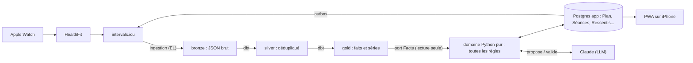

# Architecture de running : référence et apprentissage

Ce document explique **pourquoi** l'architecture de l'application est ce qu'elle est, et sert de support pour apprendre les technologies qu'elle utilise. Il complète deux documents sans les remplacer :

- [le spine d'architecture](../_bmad-output/planning-artifacts/architecture/architecture-running-2026-11-22/ARCHITECTURE-SPINE.md) : le contrat que le code doit respecter (règles AD-1 à AD-29). Il dit **quoi**, sans justifier ;
- [le memlog](../_bmad-output/planning-artifacts/architecture/architecture-running-2026-11-22/.memlog.md) : le journal brut de chaque décision, dans l'ordre où elle a été prise.

En cas de désaccord, le spine fait foi. Ce document date du 25/11/2026 ; si le spine change, mets à jour la section concernée.

## Sommaire

1. [L'architecture en une image](#1-larchitecture-en-une-image)
2. [Les grandes décisions et leurs raisons](#2-les-grandes-décisions-et-leurs-raisons)
3. [Concepts à connaître](#3-concepts-à-connaître)
4. [Parcours d'apprentissage](#4-parcours-dapprentissage)
5. [Comment lire le spine](#5-comment-lire-le-spine)
6. [Glossaire technique](#6-glossaire-technique)

---

## 1. L'architecture en une image



Il faut retenir trois idées :

1. **Deux natures de données.** Les **faits** viennent d'intervals.icu (tes Courses, ta FC au repos) et passent par un pipeline de données. L'**état de l'app** (ton Plan, tes Ressentis, tes modifications) est écrit par toi ou par l'app, et vit dans une base classique. Les deux ne se mélangent jamais.
2. **Toutes les règles vivent dans un seul endroit : le domaine.** C'est du Python pur, sans base de données ni réseau, donc testable en millisecondes. Le front n'a aucune règle, le LLM n'a aucun pouvoir de décision, et dbt ne fait aucun calcul métier.
3. **« Le LLM raconte, le code compte. »** Claude propose un squelette de Plan ou un texte de Feedback. Le code vérifie chaque nombre et chaque garde-fou avant que quoi que ce soit ne soit enregistré.

---

## 2. Les grandes décisions et leurs raisons

Chaque décision indique l'AD du spine qui la porte.

### 2.1 Monolithe modulaire à cœur hexagonal (AD-1)

**Ce qui a été décidé.** Un seul programme Python, en deux processus (`api` pour répondre au téléphone, `worker` pour les tâches longues). Au centre, un **domaine** pur. Autour, des **ports** (des interfaces) et des **adaptateurs** (les implémentations : intervals.icu, Postgres, Anthropic).

**Pourquoi.**
- Tu es seul à développer : des microservices ajouteraient du réseau, du déploiement et des pannes sans rien apporter.
- L'hexagone protège ce qui compte, c'est-à-dire les règles d'entraînement, de tout ce qui change : l'API intervals.icu, le fournisseur du LLM, le transport vers la montre (principe 6 du PRD).
- Les tests du domaine n'ont besoin ni de Docker ni de réseau.

**Alternative écartée.** Une app « FastAPI + ORM » où chaque route contient sa logique. C'est plus rapide à démarrer, mais une même règle (par exemple le plafond de +10 %) finirait dupliquée dans trois routes.

### 2.2 Deux magasins : Postgres pour l'app, DuckLake pour les faits (AD-2)

**Ce qui a été décidé.**
- Base Postgres `app` pour l'état de l'app.
- Lakehouse **DuckLake** pour les faits : catalogue dans une base Postgres `lake`, données en fichiers Parquet, DuckDB comme moteur de calcul piloté par dbt.
- L'app lit le lake en lecture seule, et dbt lit l'app en lecture seule. Des rôles Postgres distincts l'imposent.

**Pourquoi.**
- Tu voulais un vrai pipeline ELT en architecture medallion, et apprendre DuckDB, dbt et la modern data stack. C'est un critère légitime, tant qu'il n'ajoute pas de complexité *seulement* pour apprendre (principe 2 du PRD).
- Séparer les deux magasins règle une tension réelle : un `dbt run` ne doit jamais pouvoir écraser une donnée que tu as saisie, comme un Ressenti.
- Tu as choisi Postgres pour l'état de l'app plutôt que DuckDB seul, parce qu'il **scale mieux si l'app grandit** : DuckDB n'accepte qu'un écrivain à la fois.
- DuckLake plutôt que « tout dans Postgres » : le jour où tu passes au cloud, il suffit de déplacer les Parquet sur S3. C'est un changement de configuration, pas une réécriture.

**Alternatives écartées.**
- B1, « Postgres-centré » : DuckDB calcule, puis le résultat est réécrit dans Postgres. On apprend moins le lakehouse.
- Une seule base DuckDB : son écrivain unique se heurterait à l'API et au worker en même temps.

### 2.3 Un seul propriétaire par calcul (AD-3)

**Ce qui a été décidé.**
- **dbt ne produit que des faits bruts** : la plus longue Course par jour, le meilleur effort par distance, les streams découpés par lap.
- **Toutes les règles** (fenêtres de 30 jours, Conformité, garde-fous, Seuil d'allure, surmenage) sont des fonctions Python du domaine.
- Le Bilan de fin de Plan est calculé par le domaine, puis figé (AD-24).

**Pourquoi.** Si la règle des « 30 jours » existe en SQL dans un modèle dbt **et** en Python dans un garde-fou, elles finiront par diverger. Une règle a donc un seul endroit, et un test qui la recalcule.

**À retenir pour dbt.** dbt sert ici à *modéliser des faits* : nettoyer, dédupliquer, agréger sans paramètre métier. Il ne sert pas à *décider*. C'est une bonne discipline à garder dans un vrai projet data.

### 2.4 Le LLM propose, le domaine valide (AD-7, AD-9)

**Ce qui a été décidé.**
- Claude produit seulement un **squelette** de Plan : date, type, volume, référence d'intensité et justification de chaque Séance. Le code construit les Blocs et résout les allures.
- Tout texte produit par le LLM passe par un **extracteur de nombres** unique : un nombre absent des faits fournis fait rejeter la sortie, avec 3 tentatives au plus.
- La Méthode d'entraînement est choisie par une règle fixe, jamais par le LLM.

**Pourquoi.**
- La crédibilité (SM-5) : un seul chiffre inventé détruit la confiance.
- Le coût et la latence (NFR-4, NFR-9) : un squelette coûte moins de tokens qu'un Plan complet.
- La reproductibilité : deux Séances du même type ont toujours la même structure.

### 2.5 Les cibles sont des plages résolues par le code (AD-8)

**Ce qui a été décidé.** Une cible de Bloc est d'abord une **référence** (« zone 2 », « allure T »). Le domaine la transforme en plage absolue `{low, high}` à partir de ton Seuil d'allure, puis la stocke avec un instantané des réglages utilisés. La Conformité compare toujours ta Course à cette plage stockée.

**Pourquoi.** Si tes réglages changent demain, l'analyse d'hier reste juste : on sait exactement contre quoi tu as été jugé.

### 2.6 Le Seuil d'allure appartient à l'app (AD-27)

**Ce qui a été décidé.**
- L'app calcule elle-même ta vitesse critique, sur tes meilleurs efforts en GAP des 16 dernières semaines.
- Elle la versionne, et chaque changement devient un Ajustement que tu confirmes. Le seuil en vigueur est **le dernier seuil confirmé**.
- Elle ne lit **ni n'écrit** le seuil d'intervals.icu (Q10, option A).

**Pourquoi.**
- Avoir deux vérités sur la même allure, celle de l'app et celle d'intervals.icu, c'est la garantie d'une divergence.
- Écrire dans intervals.icu ajouterait une deuxième voie d'écriture, et tu ne consultes pas intervals.icu.
- Les Séances sont publiées en allures absolues, donc la montre n'a pas besoin du seuil d'intervals.icu. Un spike (OQ-4) vérifie que c'est bien vrai côté HealthFit.

**Le piège évité par la relecture.** Sans fenêtre bornée, une estimation faite pendant une reprise après blessure aurait réintégré tes efforts d'avant l'arrêt, et effacé la prudence du Mode Reprise. La fenêtre commence donc à la date de reprise (AD-27, AD-28).

### 2.7 Hiérarchie des données imposée par le code (AD-26)

**Ce qui a été décidé.**
- La puissance, la VO2max, la VFC et le sommeil Apple ne sont **pas extraits** du JSON brut.
- Chaque modèle `gold` est marqué `decision` ou `descriptive`, et un test en CI vérifie qu'aucune règle ne lit un fait `descriptive`. La CTL, la température et le découplage sont `descriptive`.

**Pourquoi.** La recherche du 25/11 montre que les mesures Apple les plus riches sont les moins fiables. Une convention écrite ne suffit pas : une story pressée utiliserait la VFC « parce qu'elle est là ». Un test qui casse, si.

### 2.8 Publication via une outbox (AD-5)

**Ce qui a été décidé.**
- Modifier une Séance écrit, **dans la même transaction**, une ligne dans une table `publication_outbox`.
- Le worker publie ensuite vers intervals.icu.
- Un échec n'annule jamais ta modification : l'écran de synchro affiche ⚠️.

**Pourquoi.** intervals.icu est un tiers que tu ne contrôles pas. Sans outbox, deux mauvais cas sont possibles : soit tu perds ta modification quand l'API tombe, soit tu publies une Séance qui n'a jamais été enregistrée.

### 2.9 Deux files de tâches dans Postgres (AD-6)

**Ce qui a été décidé.** **Procrastinate**, une file de tâches stockée dans Postgres, avec deux files :
- **`lake`** (une tâche à la fois) : synchro, ingestion, dbt, publications ;
- **`interactive`** : Feedback, génération de Plan, demande à l'IA.

**Pourquoi.**
- DuckLake ne supporte pas bien deux écritures concurrentes.
- Ton Feedback (moins de 30 s, NFR-9) ne doit pas attendre derrière un `dbt build`.
- Avoir la file dans Postgres évite d'ajouter Redis ou RabbitMQ.

### 2.10 Le temps a un seul maître (AD-14, AD-20)

**Ce qui a été décidé.**
- Un port `Clock` est la seule source de « maintenant ». Un appel à `now()` ailleurs est interdit et vérifié en CI.
- Toutes les transitions dues au temps (Séance manquée, Plan terminé) passent par un seul cas d'usage, `advance_calendar`.

**Pourquoi.** Une Course courue à 23 h 30 ne doit pas être rattachée au lendemain parce que le serveur est en UTC. Et les tests doivent pouvoir « avancer le temps ».

### 2.11 Hébergement : petit VPS derrière Tailscale (AD-17, AD-25)

**Ce qui a été décidé.**
- En dev : ton Mac.
- En prod : un VPS ARM d'environ 6 €/mois (type Hetzner CAX11), en Docker Compose, accessible **uniquement** par Tailscale.
- Une sauvegarde chiffrée part chaque nuit (restic) vers un stockage objet.

**Pourquoi.**
- Rien n'est exposé sur Internet, donc aucune authentification à coder en v1.
- Le coût reste minimal, et c'est un premier pas concret vers le cloud.

### 2.12 Versions épinglées et spikes avant de coder (AD-19, Open Questions)

**Ce qui a été décidé.**
- DuckDB reste épinglé en 1.5.6, et non en 2.0, sortie trop récemment. PostgreSQL reste en 18, pas en 19.
- Chaque point incertain devient un spike d'une demi-journée en tête de son epic :
  - OQ-1 : publication avec une clé API ;
  - OQ-2 : DuckLake avec dbt ;
  - OQ-4 : GAP et cibles d'allure sur la montre ;
  - OQ-5 : contenu du FIT HealthFit ;
  - OQ-6 : durée de sommeil.

**Pourquoi.** NFR-8 : « pas d'échéance, on préfère livrer moins mais stable ».

---

## 3. Concepts à connaître

### 3.1 Architecture hexagonale (ports et adaptateurs)

Le cœur, le domaine, ne connaît que des interfaces. Exemple :

```python
# application/ports.py : le domaine dépend de cette interface…
class Facts(Protocol):
    def longest_run_by_day(self, athlete_id: UUID, start: date, end: date) -> list[DailyLongest]: ...

# adapters/facts/duckdb_facts.py : …et cette classe l'implémente avec DuckDB.
class DuckDbFacts:
    def longest_run_by_day(self, athlete_id, start, end):
        return self._con.execute("select … from gold_daily_longest_run where …").fetchall()
```

En test, on passe un faux `Facts` qui renvoie une liste en mémoire. Si tu connais Java, c'est l'inversion de dépendances avec des interfaces et l'injection par constructeur, sans framework.

### 3.2 ELT et architecture medallion

Tu connais l'**ETL** avec Informatica : on transforme *avant* de charger. L'**ELT** inverse l'ordre. On charge le brut d'abord, puis on transforme dans le moteur analytique, en SQL versionné.

| Couche | Contenu ici | Équivalent Informatica |
| --- | --- | --- |
| `bronze` | JSON brut d'intervals.icu, en ajout seul, avec `fetched_at` | zone de staging / landing |
| `silver` | Activités dédupliquées et typées, suppressions marquées | ODS nettoyé |
| `gold` | Faits et séries prêts à lire : meilleur effort par distance, volume par jour | datamart |

Le brut est **gardé pour toujours** : on peut tout reconstruire avec `dbt build`.

### 3.3 DuckDB

C'est une base analytique **embarquée**, comme SQLite mais en colonnes. Elle tourne dans le processus Python, sans serveur, lit le Parquet nativement et est très rapide pour les agrégats. Dans ce projet, elle est **sans état** : elle calcule, mais les données vivent dans DuckLake.

Pour commencer : `pip install duckdb`, puis `duckdb.sql("select * from 'fichier.parquet'")`.

### 3.4 DuckLake

C'est un **format de lakehouse**, de la même famille qu'Iceberg ou Delta. Les données sont des fichiers Parquet. La liste des tables, de leurs versions et de leurs fichiers vit dans un **catalogue SQL**, ici une base Postgres. On y gagne des transactions, des instantanés (*time travel*) et l'évolution du schéma, sans service supplémentaire. Le spike OQ-2 sert justement à le prendre en main.

### 3.5 dbt

C'est un outil qui transforme des fichiers `.sql` (des « modèles ») en tables, dans l'ordre de leurs dépendances (`ref()`). Il les teste (`unique`, `not_null`, tests maison) et les documente. Les éléments à connaître ici :

- **`dbt-duckdb`** : l'adaptateur qui fait tourner dbt sur DuckDB et DuckLake.
- **`config.meta`** : des métadonnées libres sur un modèle. Le projet s'en sert pour marquer `interface: true` et `usage: decision|descriptive` (AD-26).
- **`dbt build`** : il lance et teste les modèles en une seule commande. On le limite aux modèles touchés (`--select state:modified+` ou une sélection par source).

### 3.6 Outbox transactionnelle

Elle résout un problème classique : écrire en base **et** appeler une API, de façon atomique. On écrit une « intention de publier » dans la même transaction que la modification, puis un processus séparé la publie et réessaie en cas d'échec.

### 3.7 Machines à états

Un Plan, une Séance, un Feedback ou un Seuil d'allure ont un nombre fini d'états, avec des transitions explicites (AD-21). Toute transition absente de la table est interdite. Cela évite qu'un « Reprendre » crée un nouveau Plan au lieu de réactiver l'ancien.

### 3.8 Idempotence

Une opération est idempotente si la rejouer ne change rien. La synchro, l'ingestion, le Ressenti et `advance_calendar` le sont tous. C'est ce qui permet de relancer une tâche interrompue sans créer de doublon.

### 3.9 Tailscale

C'est un réseau privé chiffré (WireGuard) entre tes appareils. `tailscale serve` expose l'app en HTTPS **seulement** à tes appareils, et le certificat est fourni. Pas de port ouvert, pas de nom de domaine public.

---

## 4. Parcours d'apprentissage

Ce parcours suit l'ordre de livraison : un squelette vertical d'abord (PRD §9.1). Chaque étape est rattachée à du vrai travail du projet.

| Étape | Ce que tu apprends | Où dans le projet |
| --- | --- | --- |
| 1 | `uv`, structure d'un projet Python, pytest | ossature `backend/`, tests du domaine |
| 2 | Architecture hexagonale, ports, faux adaptateurs | premier cas d'usage et ses tests |
| 3 | DuckDB en local sur des Parquet | lire un export d'activités intervals.icu |
| 4 | DuckLake + dbt-duckdb, couches medallion | spike OQ-2, puis `bronze` → `gold` |
| 5 | Tests dbt, `meta`, sélection de modèles | modèles `gold` d'interface (AD-26) |
| 6 | Postgres, Alembic, transactions, `FOR UPDATE` | base `app`, verrou du Plan (AD-4) |
| 7 | Files de tâches (Procrastinate), idempotence | synchro sur la file `lake` (AD-6) |
| 8 | API structurées du LLM, validation, coût | génération du squelette (AD-7, AD-9) |
| 9 | Docker Compose, images arm64, GHCR, CI | déploiement (AD-25) |
| 10 | VPS, Tailscale, sauvegardes chiffrées, restauration | mise en usage (AD-19) |

Plus tard, l'étape cloud consistera à passer les Parquet sur S3, ou à utiliser MotherDuck, et à essayer un orchestrateur (Dagster) : c'est l'élément « Passage au cloud » des Deferred du spine.

---

## 5. Comment lire le spine

- **AD-n** : une règle que deux epics doivent respecter de la même façon. Chaque AD a trois champs :
  - **Binds** : les exigences du PRD qu'il couvre ;
  - **Prevents** : la divergence qu'il empêche ;
  - **Rule** : la règle elle-même.
- **Consistency Conventions** : nommage, unités, formats d'erreur.
- **Stack** : les versions minimales. Le lockfile fait foi.
- **Structural Seed** : l'état de départ (diagrammes, arborescence). Une fois le code écrit, c'est **le code** qui fait foi.
- **Open Questions** : les spikes à faire avant de coder l'epic concernée.
- **Deferred** : ce qui n'est volontairement pas décidé en v1.

Les numéros AD ne changent jamais. Une règle retirée garde son numéro, qui n'est pas réutilisé.

---

## 6. Glossaire technique

| Terme | Sens dans ce projet |
| --- | --- |
| **AD** | *Architecture Decision* : une règle numérotée du spine |
| **Adaptateur** | Code qui implémente un port pour une technologie précise (DuckDB, Anthropic…) |
| **Cas d'usage** | Fonction de `application/` qui modifie l'état, dans une transaction (AD-4) |
| **CS (vitesse critique)** | Base du Seuil d'allure : pente de la droite distance / temps sur tes meilleurs efforts |
| **CTL** | Charge chronique calculée par intervals.icu ; descriptive seulement |
| **`decision` / `descriptive`** | Usage d'un fait : peut fonder une règle, ou seulement être affiché (AD-26) |
| **Domaine** | Code Python pur qui contient toutes les règles du PRD |
| **`dry_run`** | Exécution des garde-fous sans rien enregistrer, pour griser les boutons du front |
| **ELT** | *Extract, Load, Transform* : charger le brut, puis transformer dans le moteur |
| **GAP** | Allure ajustée à la pente ; source unique : intervals.icu |
| **Idempotent** | Rejouable sans effet supplémentaire |
| **Lakehouse** | Fichiers ouverts (Parquet) + catalogue transactionnel |
| **Medallion** | Organisation en couches bronze / silver / gold |
| **Outbox** | Table d'intentions de publication écrite dans la même transaction (AD-5) |
| **Parquet** | Format de fichier en colonnes, compressé, standard de la data |
| **Port** | Interface que le domaine utilise pour parler au monde extérieur |
| **`proposal`** | Changement proposé (Imprévu, surmenage, seuil, IA), appliqué seulement après ta confirmation (AD-4) |
| **RFC 9457** | Format standard des erreurs d'API (`application/problem+json`) |
| **Spike** | Essai court et jetable pour lever une incertitude technique |
| **Spine** | Le contrat d'architecture : les règles qui gardent les epics cohérentes |
| **UUID v7** | Identifiant unique triable dans le temps, généré par le backend |
